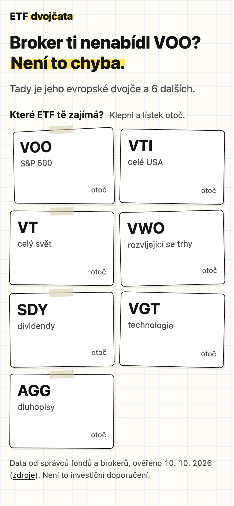
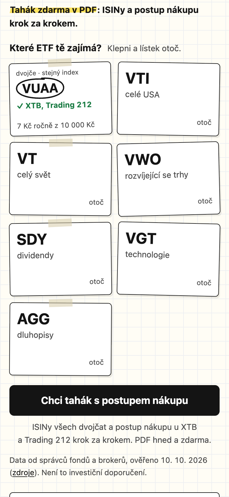
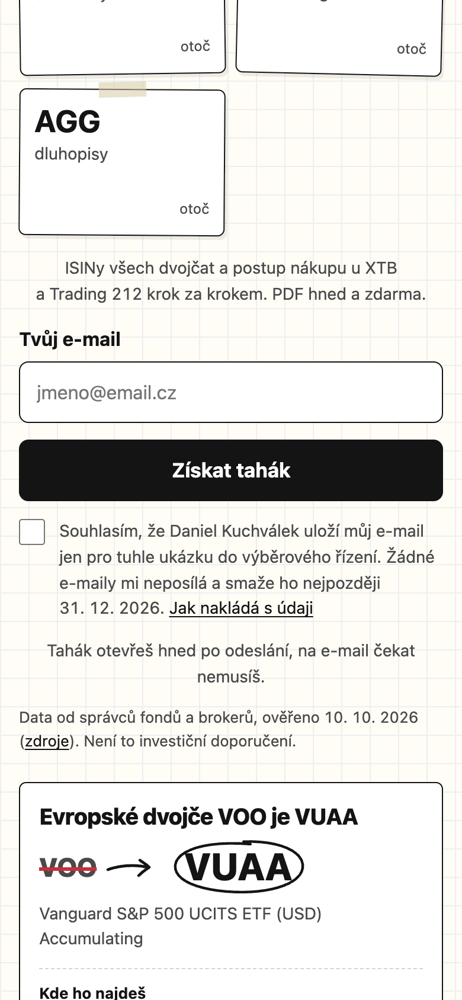
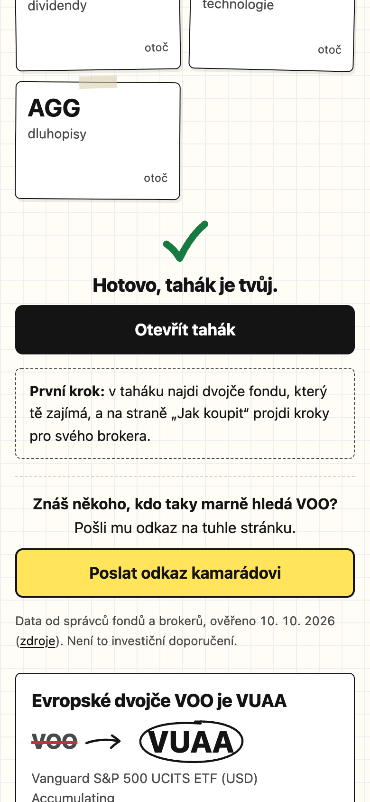
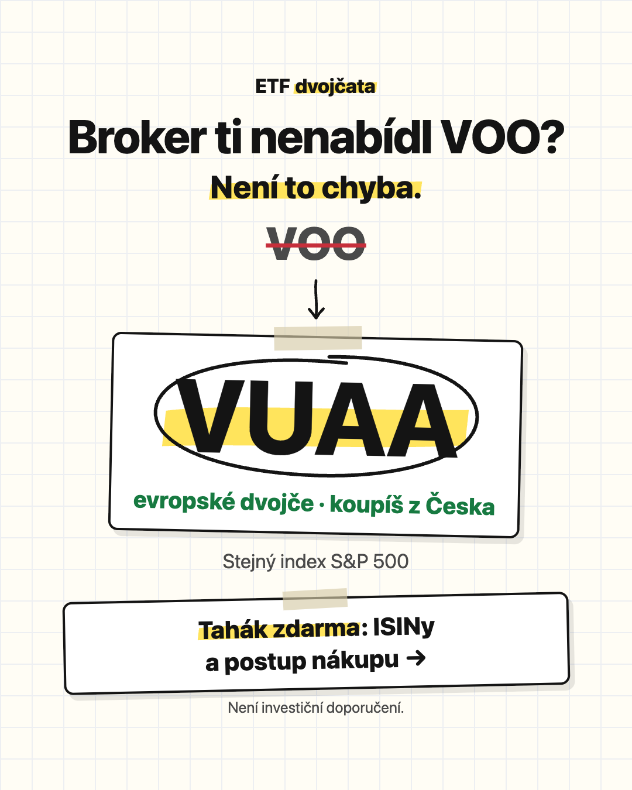
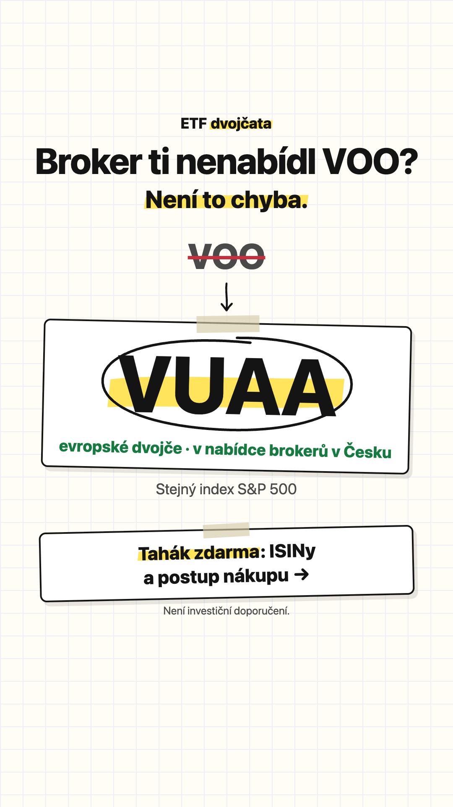
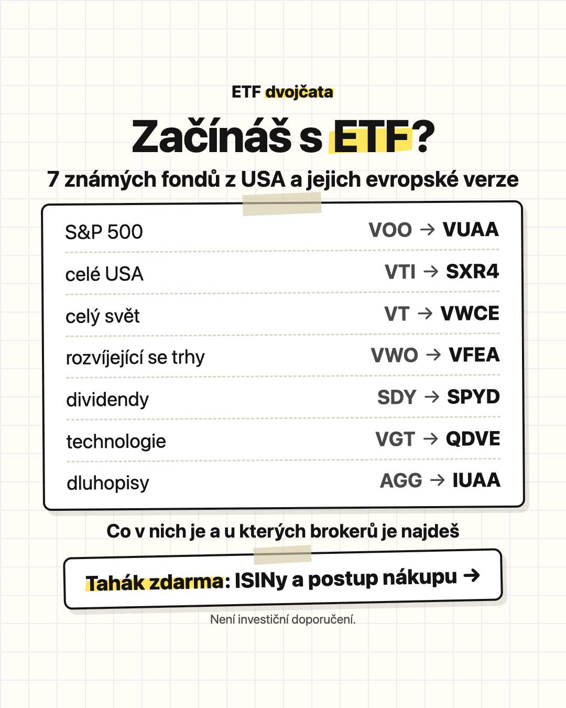
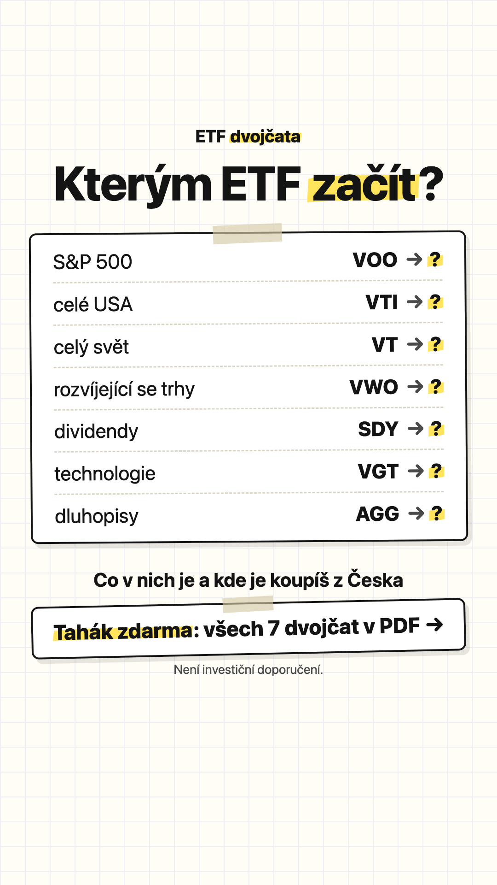
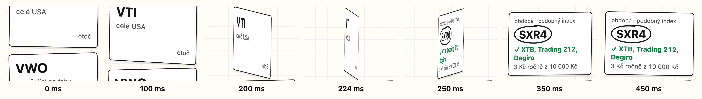

# ETF dvojčata – konverzní landing page (zadání B)

- **Živá stránka** (nasazeno 11. 10. 2026): [etf-dvojcata-demo.vercel.app](https://etf-dvojcata-demo.vercel.app/) · reklama A „Dvojče“: [?v=dvojce](https://etf-dvojcata-demo.vercel.app/?v=dvojce) · reklama B „Začátek“: [?v=zacatek](https://etf-dvojcata-demo.vercel.app/?v=zacatek)
- **Myšlenka:** americká ETF ti broker v Česku často nenabídne. Stránka k 7 známým ETF z NYSE jedním klepnutím ukáže evropské „dvojče“, které koupíš, a za e-mail dá PDF tahák s postupem nákupu.
- **Očekávaná konverze** (návštěva → odeslaný formulář): 2–13 %, nejspíš kolem 6 %. Je to odhad, [výpočet po krocích](#očekávaná-konverze).
- **Do ostrého spuštění chybí:** posouzení právníkem, rozhodnutí o double opt-inu, údaje a e-mailová služba od správce, ověření pravidel Meta pro finanční reklamu a vlastní doména ([seznam](#před-spuštěním-kampaně)).

## Jak to vyzkoušet za 2 minuty

**Na mobilu:**

1. Otevři [etf-dvojcata-demo.vercel.app/?v=dvojce](https://etf-dvojcata-demo.vercel.app/?v=dvojce). Nadpis navazuje na reklamu A, pro srovnání zkus [?v=zacatek](https://etf-dvojcata-demo.vercel.app/?v=zacatek).
2. Klepni na lístek **VOO**. Otočí se a ukáže evropské dvojče VUAA, u kterých brokerů ho koupíš a kolik stojí ročně z 10 000 Kč. Pod lístky se objeví výzva k taháku.
3. Klepni na „Chci tahák se všemi 7 dvojčaty“, zadej e-mail, zaškrtni souhlas a odešli. Přijde poděkování s tlačítkem „Otevřít tahák“ (PDF) a sdílením. Když stránku posuneš dál, objeví se dole lišta, která formulář otevře jako panel.
4. Ochrana formuláře: zkus `x@mailinator.com` (jednorázová adresa) nebo `test@neexistuje.invalid` (doména nepřijímá poštu).

Takhle to vypadá na iPhonu 13 (390 × 844). Úvod, lístek a formulář jsou z živé stránky (11. 10. 2026, požadavky na `/api/` zablokované, nic se neodeslalo), poděkování z lokálního serveru s podvrženou databází:

| Úvod (`?v=dvojce`) | Otočený lístek | Formulář pod lístky | Poděkování |
|---|---|---|---|
|  |  |  |  |

**Kde je vidět trychtýř:**

- **Na živé stránce** v Supabase: SQL Editor → `select * from analytika.trychtyr;` (příchod → otočení lístku → otevření formuláře → odeslání, zvlášť pro každou verzi úvodu). Projekt je na mém účtu, výstup rád ukážu nebo přidám přístup.
- **Lokálně bez Supabase:** `./scripts/serve.sh`, projdi stránku na http://127.0.0.1:8737/ a otevři http://127.0.0.1:8737/__dev/trychtyr. Server používá stejné SQL nad Postgresem v paměti (PGlite).

Exporty konverzací s AI jsou v [ai-log/](ai-log/), reklamy v [reklamy/](reklamy/).

## Cílová skupina

**Začínající investoři ve věku 25–40 let.** O ETF už slyšeli z YouTube, TikToku nebo od kamaráda. Někteří zkoušeli VOO najít u brokera a nešlo to. Chtějí začít, ale bojí se, že vyberou špatně nebo přeplatí na poplatcích. Přicházejí z reklamy na Instagramu nebo Facebooku, na mobilu, a stránce dají pár sekund.

**Proč právě oni:**

- Vědí, co je ETF, a mají konkrétní problém: fond, o kterém slyšeli, u brokera nenajdou. Stránka jim ten problém vyřeší jedním klepnutím, takže hodnotu vidí okamžitě.
- Jsou blízko k akci. Nepotřebují vysvětlovat, proč investovat, jen co koupit a jak.
- Začátečníky, kteří nevědí, kterým ETF začít, oslovuje reklama B. Testujeme tak druhou motivaci: nejistotu místo zklamání z brokera.

**Stavíme na ověřeném faktu:** americká ETF ti broker v Česku často nenabídne, evropská obdoba ano. Například u Trading 212 je pro evropské klienty vyloučeno 1 137 z 1 151 amerických ETF (viz [data/README.md](data/README.md)). Tuhle informaci návštěvník jinde snadno nenajde a je to hlavní důvod, proč na stránce zůstat.

## Lead magnet a moment žádosti o kontakt

**Co návštěvník dostane:** PDF „Tahák: 7 ETF z NYSE a jejich dvojčata, která koupíš z Česka“ ([public/tahak.pdf](public/tahak.pdf), 8 stran A5): ISINy, poplatky, kde koupit a postup nákupu u XTB a Trading 212 krok za krokem, se zdrojem u každého kroku. Generuje se z [tahak/tahak.html](tahak/tahak.html) a dat, takže po změně dat stačí přegenerovat.

**Hodnota je vidět ještě před formulářem.** Lístky se 7 ETF jsou na první obrazovce. Klepnutím se lístek otočí a ukáže evropské dvojče, u kterých brokerů ho koupíš a kolik stojí ročně z 10 000 Kč. Pod lístky se ukážou podrobnosti (index, poplatek proti originálu, dividendy). Zdarma, bez e-mailu. Dělba je jasná: na stránce návštěvník vidí, **co** koupit, v taháku dostane, **jak** to udělat.

**Kdy žádáme o kontakt:**

1. Hned po prvním otočení lístku: pod lístky se objeví „Chci tahák se všemi 7 dvojčaty“. Návštěvník právě dostal hodnotu a ví, že zbylých 6 párů a postup jsou v taháku. Formulář se rozbalí na místě.
2. Spodní lištou, která se ukáže, když lístky zmizí z obrazovky a výzva ani formulář nejsou vidět. Formulář se otevře jako panel tam, kde návštěvník právě je.
3. Formulářem v sekci Tahák pro ty, kdo dočtou až dolů.

**Formulář:** jen e-mail a souhlas (proč, je v [obchodním pohledu](#obchodní-pohled)). Tlačítko je hned pod polem, aby ho na iPhonu nezakryla klávesnice ani lišta s návrhy e-mailů.

**Po odeslání:** poděkování s tlačítkem „Otevřít tahák“, takže nikdo nečeká na e-mail. Pod ním je věta s prvním krokem a „Poslat odkaz kamarádovi“ (nativní sdílení telefonu, jinak zkopírování odkazu). Sdílení měříme a sdílený odkaz má `?ref=sdileni`. PDF se samo nestahuje: Safari na iPhonu ho při testu místo stažení otevřel a návštěvník by odešel dřív, než uvidí sdílení.

Texty všech částí jsou v [texty.md](texty.md).

## Pořadí sekcí a zdůvodnění

1. **Úvod navazující na reklamu a rovnou lístky s ETF.** Návštěvník má jen pár sekund. První obrazovka musí zopakovat slib reklamy a nabídnout akci bez scrollování. Nadpis se mění podle toho, ze které reklamy návštěvník přišel (viz [reklamy/](reklamy/)).
2. **Výsledek a výzva k taháku.** Otočený lístek ukáže dvojče, kde ho koupíš a kolik stojí: okamžitá hodnota zdarma. Výzva se objeví hned pod lístky ve chvíli, kdy je zájem nejvyšší, a formulář se rozbalí na místě. Pod ní jsou podrobnosti (index, poplatek proti originálu, dividendy).
3. **Přehled všech 7 párů v kompaktních kartách.** Pro ty, kdo chtějí vidět celek, než se rozhodnou. Karty zvýrazňují „✓ koupíš u …“ a poplatek ukazují lidsky v korunách; ISINy a postup zůstávají v taháku.
4. **Proč ti broker americká ETF často nenabídne (2–3 věty).** Vysvětlení, proč dvojčata vůbec potřebujeme. Až tady, protože ten, kdo přišel z reklamy „Dvojče“, už důvod zná z úvodu a nechce ho číst před výsledkem.
5. **Důvěra: zdroje dat s datem a upozornění, že nejde o investiční doporučení.** Těsně před formulářem odpovídá na otázku „můžu tomu věřit?“. Krátká verze (zdroj, datum, „Není to investiční doporučení“) je i hned pod lístky.
6. **Formulář (e-mail a souhlas).** Pro ty, kdo dočetli až sem. Výzvy ze sekce 2 a z lišty dole sem nevedou, otevírají formulář na místě: skok přes tři sekce stojí konverze a návštěvník ztratí kontext. Tuhle změnu oproti původnímu návrhu navrhla AI (Claude Code).
7. **Krátké FAQ (Je to zdarma? Co s mým e-mailem?).** Odstraní poslední obavy u formuláře, hlavně strach ze spamu.

## Dvě verze reklamy

Obě pro Meta (Facebook a Instagram) na mobilu: statický obrázek 4 : 5 do feedu a 9 : 16 do Stories a Reels, tlačítko „Zjistit víc“. Texty jsou v [reklamy/](reklamy/README.md). Obrázky generuje [scripts/reklamy.mjs](scripts/reklamy.mjs) z HTML ve stylu stránky (sešit, fix, lístky), takže jdou upravit a přegenerovat. Každá má nahoře hook z primárního textu, dole nabídku „Tahák zdarma: všech 7 dvojčat v PDF →“ (stejný slib jako výzva na stránce) a drobně „Není investiční doporučení.“ A ukazuje dvojče VOO, B dvojčata záměrně neukazuje („→ ?“ u tickerů), odpověď je v taháku. U Stories a Reels je text mimo horních 270 px a dolních 450 px, kde je ovládání aplikace.

| | Feed 1080 × 1350 | Stories a Reels 1080 × 1920 |
|---|---|---|
| **A „Dvojče“** |  |  |
| **B „Začátek“** |  |  |

| | A „Dvojče“ ([a-dvojce.md](reklamy/a-dvojce.md)) | B „Začátek“ ([b-zacatek.md](reklamy/b-zacatek.md)) |
|---|---|---|
| Úhel | zklamání: broker nenabízí VOO, o kterém slyšeli | nejistota: nevědí, kterým ETF začít |
| Primární text začíná | „Broker ti nenabídl VOO? Není to chyba.“ | „Nevíš, kterým ETF začít?“ |
| Obrázek | VOO → VUAA, „evropské dvojče · koupíš z Česka“ | sešit se 7 typy ETF a tickery, nic nezakroužkované |
| Nadpis první obrazovky | Broker ti nenabídl VOO? Není to chyba. | Nevíš, kterým ETF začít? |
| Pro koho | 25–40 let, o ETF už slyšeli a VOO možná zkoušeli koupit | 25–40 let, s ETF teprve začínají a konkrétní fond nehledají |
| Kam vede | [etf-dvojcata-demo.vercel.app/?v=dvojce](https://etf-dvojcata-demo.vercel.app/?v=dvojce) | [etf-dvojcata-demo.vercel.app/?v=zacatek](https://etf-dvojcata-demo.vercel.app/?v=zacatek) |
| Co od ní čekáme | Lidé přijdou s konkrétním problémem a hned otočí VOO. Čekám vyšší podíl otočení i odeslání než u B, protože slib reklamy vyřeší první lístek. | Lidé si spíš projdou víc lístků, než se rozhodnou. Čekám nižší konverzi než u A (nehledají konkrétní fond), ale možná víc otočených lístků na návštěvu. |

**Jak navazuje první obrazovka:** nadpis a podnadpis se mění podle `?v=` (malý inline skript hned za nadpisem, layout se neposune), zbytek stránky je pro obě verze stejný. Rozdíl v konverzi tak jde připsat reklamě a úvodu. Verze se ukládá k událostem i ke kontaktu, takže trychtýř je zvlášť pro každou. Obě reklamy mají běžet ve stejné kampani se stejným publikem a rozpočtem. Očekávání v tabulce jsou moje hypotézy, ne čísla ze zdroje. Rozhodne trychtýř podle verze úvodu (`analytika.trychtyr`): která verze přivede víc odeslaných formulářů na návštěvu a jak se liší otočení lístků. Odkazy v reklamách mají i `utm_source=meta&utm_medium=paid_social&utm_campaign=etf-dvojcata&utm_content=a-dvojce` (nebo `b-zacatek`), aby se kampaň dala porovnat i v Ads Manageru.

## Očekávaná konverze

**Odhad: 2–13 % návštěv odešle formulář, nejspíš kolem 6 %.** Konverze je návštěva (načtená stránka) → odeslaný formulář, stejně jako v trychtýři. **Všechna procenta v tabulce jsou můj odhad**, ne naměřená data. Po prvním týdnu kampaně je nahradí čísla z `analytika.trychtyr`.

| Krok trychtýře | Pesimisticky | Středně | Optimisticky | Z čeho odhad vychází |
|---|---|---|---|---|
| 1. příchod | 100 % | 100 % | 100 % | výchozí bod, každá načtená stránka |
| 2. otočení lístku (z příchodů) | 25 % | 40 % | 55 % | Lístky jsou na první obrazovce a jsou přesně to, co reklama slibuje. Z reklamy na sociálních sítích ale velká část lidí odejde po pár sekundách bez jediného klepnutí. |
| 3. otevření formuláře (z těch, kdo otočili) | 20 % | 30 % | 40 % | Výzva se objeví hned pod otočeným lístkem. Kdo ale viděl dvojče, už dostal, kvůli čemu přišel, a tahák ho musí zaujmout navíc. |
| 4. odeslání (z otevřených formulářů) | 40 % | 50 % | 60 % | Jedno pole a zaškrtnutí, tahák hned bez čekání na e-mail. Část lidí odradí, že dávají e-mail a souhlas s e-maily. |
| **Návštěva → odeslání** | **2,0 %** | **6,0 %** | **13,2 %** | součin kroků 2–4 |

**Výpočet po krocích na 1 000 návštěv:**
- středně: 1 000 × 40 % = 400 otočí lístek → 400 × 30 % = 120 otevře formulář → 120 × 50 % = 60 odešle, tedy 6,0 %,
- pesimisticky: 1 000 × 25 % = 250 → 250 × 20 % = 50 → 50 × 40 % = 20, tedy 2,0 %,
- optimisticky: 1 000 × 55 % = 550 → 550 × 40 % = 220 → 220 × 60 % = 132, tedy 13,2 %.

Zjednodušení: formulář jde otevřít i bez otočení lístku (spodní lišta, sekce Tahák). Tyhle cesty v odhadu zvlášť nejsou, počítám je jako součást kroku 3.

**Srovnání s benchmarkem (skutečný zdroj, ne odhad):** podle [Unbounce](https://unbounce.com/landing-pages/whats-a-good-conversion-rate/) (Conversion Benchmark Report 2024, 41 000 landing pages a 57 milionů konverzí) je medián konverze landing page napříč obory 6,6 %, ve finančních službách 8,3 % a v podkategorii investování 3,9 %. Starší [stránka Unbounce o financích](https://unbounce.com/industry/finance/) uvádí pro finance a pojištění medián 3,8 % a rok dat neuvádí. Zdroje se rozcházejí, proto mezi nimi nevybírám. Střední odhad 6 % leží mezi investováním (3,9 %) a finančními službami (8,3 %). Benchmark zahrnuje všechny zdroje návštěv a všechny druhy konverzí, nejen e-mail za PDF, a český trh v něm zvlášť není. Je to tedy jen hrubá kontrola, že odhad není mimo.

**Co konverzi nejvíc ovlivní:**
- jestli úvod navazuje na slib reklamy (proto se mění podle `?v=`),
- jestli lidé poznají, že se na lístek dá klepnout (krok 2),
- jestli je tahák lákavý i pro toho, kdo už dvojče viděl (krok 3). Na tenhle krok míří [první hypotéza na A/B test](#hypotézy-na-ab-test).

## Obchodní pohled

**K čemu je kontakt.** Co s kontakty Clientelo nebo jeho klient udělá, zadání neříká, proto to beru obecně. Kontakt je člověk, který se aktivně zajímá o ETF, viděl, které fondy si z Česka koupí, a souhlasil s e-maily o investování do ETF. Hodí se pro firmu, která na investování do ETF vydělává: broker nebo investiční platforma (otevření účtu), finanční médium nebo vzdělávání (newsletter, kurz). U kontaktu je uložená i verze reklamy, takže je vidět, s jakou motivací přišel (zklamání z brokera, nebo nejistota začátečníka), a podle toho jde psát první e-maily.

**Orientační cena za kontakt.** Cena za kontakt = cena za klik ÷ (podíl kliků, ze kterých je načtená stránka × konverze návštěva → kontakt). Předpoklady:

- **Cena za klik z Meta v Česku: předpoklad 5–20 Kč, středně 10 Kč.** Ověřený zdroj pro český trh nemám. Pro představu: [LocaliQ (WordStream)](https://localiq.com/blog/facebook-advertising-benchmarks/) uvádí u kampaní Facebooku na návštěvnost průměrnou cenu za klik 0,60 USD napříč obory a 0,86 USD pro finance a pojištění. Jsou to data z kampaní jejich klientů, český trh v nich zvlášť není a na koruny je nepřepočítávám.
- **Z kliku je načtená stránka: předpoklad 85 %.** Část lidí stránku zavře dřív, než se načte. Stránka je rychlá (LCP 1,0–1,1 s v Lighthouse na živé adrese), ztráta by tedy neměla být velká, ale změřená není.
- **Konverze: 2 %, 6 % a 13,2 %** z [odhadu výše](#očekávaná-konverze).

Výpočet střední varianty: 10 Kč ÷ (0,85 × 0,06) = 10 Kč ÷ 0,051 ≈ **196 Kč za kontakt**. Jinak řečeno: 1 000 kliků za 10 000 Kč → 850 návštěv → 51 kontaktů.

| Cena za klik | Konverze 2 % | 6 % | 13,2 % |
|---|---|---|---|
| 5 Kč | 294 Kč | 98 Kč | 45 Kč |
| 10 Kč | 588 Kč | **196 Kč** | 89 Kč |
| 20 Kč | 1 176 Kč | 392 Kč | 178 Kč |

Rozsah je široký, protože oba vstupy jsou odhady. Po pár dnech kampaně se dosadí skutečná cena za klik z Meta a konverze z trychtýře. Kontakt se vyplatí, když z něj klient v průměru vydělá víc, než stojí. To záleží na jeho byznysu, který zadání neuvádí, takže to nehádám. S double opt-inem (viz [Bezpečnost](#bezpečnost-a-ochrana-proti-spamu)) by se cena počítala na potvrzený kontakt a byla by vyšší.

**Proč jen e-mail a nic dalšího:**
- **E-mail stačí k tomu, co slibujeme.** Tahák se ukáže hned a další e-maily jdou na adresu. Jméno ani telefon k tomu nejsou potřeba.
- **Každé pole navíc je na mobilu další psaní** a další důvod formulář nedokončit. Člověk z reklamy stránce dává pár sekund.
- **Telefon by změnil, co nabízíme.** Za PDF zdarma ho návštěvník spíš nedá, protože by čekal hovor od prodejce. Je to můj předpoklad, neměřený.
- **Minimalizace údajů:** GDPR chce osobní údaje omezit na to, co je pro daný účel nezbytné (čl. 5 odst. 1 písm. c)). Méně údajů je i menší škoda při úniku.
- **Víc se dá zjistit později:** v prvním e-mailu jednou otázkou na klepnutí (třeba „U jakého brokera jsi?“). Odpoví jen ti, kdo už důvěřují, a formulář na stránce zůstane krátký.

## Hypotézy na A/B test

Seřazené podle očekávaného dopadu na konverzi návštěva → odeslání. Hlavní metrika je u všech stejná a měří ji vlastní trychtýř. Očekávaná zlepšení jsou můj odhad, ze kterého počítám potřebný počet návštěv.

**1. Formulář rovnou pod otočeným lístkem**
- **Hypotéza:** když po prvním otočení uvidí návštěvník rovnou pole na e-mail, odpadne jedno klepnutí ve chvíli největšího zájmu a víc lidí formulář odešle.
- **Co měníme:** pod lístky se místo tlačítka „Chci tahák se všemi 7 dvojčaty“, které formulář teprve rozbalí, ukáže rovnou formulář (pole, „Získat tahák“, souhlas). Zbytek stránky zůstane stejný.
- **Metrika:** návštěva → odeslání. Kontrolní: návštěva → otočení lístku (formulář pod lístky nesmí odradit od dalšího otáčení).
- **Minimum:** z 6 % na 7,5 % (+25 %) → 4 388 návštěv na verzi, **asi 8 800 celkem**.
- **Proč první:** míří na krok s největším odhadovaným úbytkem v procentech (z těch, kdo otočí lístek, formulář neotevře 70 %) a mění jen jeden prvek. Čekám od ní největší dopad.

**2. Jeden lístek otočený hned po načtení**
- **Hypotéza:** část lidí nepozná, že se na lístek dá klepnout, nebo to nezkusí. Když lístek VOO ukáže dvojče sám, hodnota je vidět bez jediné akce a víc lidí dojde k výzvě.
- **Co měníme:** lístek VOO se chvíli po načtení sám otočí na VUAA, ostatní zůstanou lícem nahoru.
- **Metrika:** návštěva → odeslání. Vedlejší: návštěva → otočení lístku, které by se mělo zvednout nejvíc.
- **Minimum:** z 6 % na 7,2 % (+20 %) → 6 717 návštěv na verzi, **asi 13 400 celkem**.
- **Proč druhá:** míří na krok 2, kde v absolutních číslech odejde odhadem nejvíc lidí (600 z 1 000), ale na odeslání působí jen nepřímo. Kdo uvidí dvojče bez klepnutí, nemusí o tahák stát. Proto čekám menší dopad než u první.

**3. Výzva slibuje „jak koupit“ místo „všech 7 dvojčat“**
- **Hypotéza:** kdo otočil lístek, už ví, co koupit, ale neví jak. Výzva, která slibuje postup nákupu, je pro něj konkrétnější než seznam, jehož část už viděl.
- **Co měníme:** text tlačítka pod lístky a ve spodní liště, například „Chci postup nákupu krok za krokem“. Formulář i tahák zůstanou stejné.
- **Metrika:** návštěva → odeslání. Vedlejší: otočení lístku → otevření formuláře.
- **Minimum:** z 6 % na 6,9 % (+15 %) → 11 690 návštěv na verzi, **asi 23 400 celkem**.
- **Proč třetí:** mění jen slova, ne počet kroků ani to, co návštěvník vidí. Čekám nejmenší efekt, a proto potřebuje nejvíc návštěv. Na druhou stranu se připraví nejrychleji.

**Výpočet minima:** n na verzi = (z₁₋α/₂ + z₁₋β)² × [p₁(1 − p₁) + p₂(1 − p₂)] ÷ (p₂ − p₁)², kde α = 0,05 oboustranně (z = 1,96) a síla testu 80 % (z = 0,84), takže (1,96 + 0,84)² ≈ 7,85. Například první hypotéza: 7,85 × (0,06 × 0,94 + 0,075 × 0,925) ÷ 0,015² = 7,85 × 0,1258 ÷ 0,000225 ≈ 4 388. Výchozí konverze 6 % je střední odhad. Kdyby skutečná byla 2 %, potřebný počet návštěv vyjde zhruba třikrát vyšší (u první hypotézy 13 807 na verzi). Výpočet je proto potřeba zopakovat s konverzí naměřenou v prvním týdnu. Při 500 návštěvách denně (předpoklad) by první test trval asi 18 dní, druhý 27 a třetí 47.

**Co je pro test potřeba připravit:** stránka zatím rozlišuje jen verzi reklamy (`?v=`). Pro test na stránce je potřeba přidat druhý parametr nebo náhodné přidělení verze při načtení (bez ukládání do prohlížeče) a ukládat ho k událostem i ke kontaktu. Testy pouštět po jednom, s délkou určenou předem a bez předčasného vyhodnocování.

## Jak jsem pracoval s AI

**Nástroje a role:**

- **Plánovací chat (claude.ai):** v samostatném chatu jsem si připravoval a ladil zadání pro Claude Code: co chci, v jakém pořadí, co ověřit a co se nesmí stát. Do Claude Code šlo až hotové zadání. Exporty v [ai-log/](ai-log/) jsou z Claude Code.
- **Claude Code** (ve VS Code) dělal výzkum dat z primárních zdrojů, stránku, PDF, funkce, SQL, testy a dokumentaci. Pravidla pro každou session i pro subagenty jsou v [CLAUDE.md](CLAUDE.md): žádná vymyšlená data (zdroj, nebo TODO), klíče jen v proměnných prostředí, nic absolutního v textech, tykání bez rodu, česká typografie, malé commity a push jen na pokyn.
- **Agenti:** většina práce běžela v jedné konverzaci. Subagenty spouštěly skilly `security-review` (hledání zranitelností a ověření každého nálezu zvlášť) a `code-review`. Co dostaly za zadání, jak se kontroloval jejich výstup a kde se spletly, je v [ai-log/denik.md](ai-log/denik.md).
- **Postup u chyb:** AI nejdřív napsala příčinu a teprve potom opravovala. U nové kontroly ověřila, že na staré verzi selže.

**Jak jsem výstupy kontroloval:**

- **Testy**, které vrací chybu, když něco neprojde: funkce s podvrženou databází a DNS, SQL na skutečném Postgresu, stránka v Chromu, WebKit s emulovanými iPhony a simulovanou klávesnicí, data proti zdrojům, čísla na stránce a v PDF proti datům, Lighthouse ([přehled a počty](#testování-co-automaticky-a-co-jen-na-telefonu)).
- **Na skutečném iPhonu**, třikrát (Safari a Chrome na iOS). Tam se našly chyby, které žádná simulace neukázala.
- **Proti zadání:** cílová skupina, hodnota viditelná před formulářem, dvě reklamy, měření celé cesty, skutečná data se zdrojem, pořadí sekcí, konverze, hypotézy, nasazení.
- **Čtením:** texty, README a diff před každým commitem (klíče, skutečné e-maily).

**Kde AI chybovala a jak se to odhalilo:**

| Chyba AI | Jak se na ni přišlo | Oprava |
|---|---|---|
| V návrhu podnadpisu absolutní tvrzení „Americké ti broker nenabídne, evropské ano.“, proti pravidlu nic netvrdit absolutně. | Člověk při čtení plánu. | „Americká ti broker často nenabídne, evropská ano.“ |
| „Pojistka“ u otočení lístku přepínala líc a rub podle času, ne podle úhlu. Lístek byl z boku dřív, než se strany vyměnily, takže na iPhonu jen blikl. Test kontroloval jen konečný stav. | Člověk na iPhonu (Chrome na iOS, s videem). Příčinu AI změřila ve WebKitu po 100 ms. | Strany se mění na konci první půlky animace. Test kontroluje každý snímek průběhu. |
| Kontrola skrytého pole proti botům v prohlížeči tiše zahazovala skutečné kontakty, když pole vyplnilo automatické vyplňování. Návštěvník viděl poděkování, ale kontakt se neuložil. | Skill `code-review` při bezpečnostní kontrole. | Rozhoduje jen server a pole má název, který automatické vyplňování nezná. |
| V README tvrdila, že kontakt nejde spárovat s návštěvou. Nebyla to pravda: řádky měly pořadová čísla a databáze zná pořadí zápisu. | Review při bezpečnostní kontrole. | Náhodná UUID, odeslání a všechno po něm bez ID návštěvy, čas na minuty a pravdivý popis toho, co zůstává. |
| Panel s formulářem po klepnutí do pole odskočil pod klávesnici. Po opravě tlačítko zakryla lišta s návrhy e-mailů nad klávesnicí. Headless Chrome ani simulace ve WebKitu klávesnici a lištu neukázaly. | Dva testy na skutečném iPhonu (člověk). | Panel podle `visualViewport`, tlačítko hned pod polem a rezerva 50 px na lištu. Test ve WebKitu lištu teď kreslí. |
| Limit 10 kontaktů za hodinu z jedné IP brala jako bezpečný pro skutečné lidi. | Člověk upozornil na sdílené IP mobilních operátorů (CGNAT). | 30 za hodinu, odmítnutí se zapisují do logu. |
| Kontrola MX odmítala doménu bez MX záznamu, i když pošta jde i na adresu domény (RFC 5321). | AI při ověřování, o které člověk požádal (fail-open při chybě DNS). | Bez MX se ověří adresa domény, timeout 1 s. |

Další drobnější chyby (odhadnutá adresa produktové stránky Vanguardu, nápověda XTB pro klienty mimo EU, test, který klepal během plynulého posunu stránky) jsou v [deníku](ai-log/denik.md).

**Testy na skutečném iPhonu dělal člověk, ne AI:**

1. **10. 10. 2026, Safari:** design působil jako typický web od AI, poděkování bylo rozbité a stránka slibovala PDF, které neexistovalo. Design se předělal na „sešit“ s lístky.
2. **10. 10. 2026, Safari:** panel s formulářem odskakoval pod klávesnici, Safari PDF místo stažení otevřelo (poděkování teď nabízí „Otevřít tahák“), poděkování bylo prázdné.
3. **11. 10. 2026, Chrome na iOS, s videem:** lístek se neotáčel, jen blikl, a tlačítko zakrývala lišta s návrhy e-mailů. Průběh otočení po opravě (WebKit, snímky po 100 ms):

   

Snímky před úpravami a po nich a snímky s klávesnicí ve WebKitu jsou v sekci [Testování](#testování-co-automaticky-a-co-jen-na-telefonu).

## Nejasnosti v zadání a moje rozhodnutí

- **„ETF obchodované na NYSE“:** beru NYSE i NYSE Arca, fondy obchodované hlavně na Nasdaqu (např. QQQ) vynechávám. Většina amerických ETF je kotovaná na NYSE Arca, která patří pod NYSE Group.
- **Americké ETF a český drobný investor:** ke každému ETF z NYSE ukazuju i evropskou UCITS obdobu, kterou si Čech opravdu koupí. Brokeři v EU drobným investorům americké ETF často neprodají, protože americké fondy nemají sdělení klíčových informací (KID) podle nařízení PRIIPs. Ověření z primárních zdrojů i výhrady (výklad ČNB k execution-only) jsou v [data/README.md](data/README.md). Stránka návštěvníkovi nemá slibovat něco, co nemůže udělat.
- **Co je „kontakt“:** jen e-mail, žádný telefon. Zadání chce co nejméně polí a e-mail stačí k doručení toho, co návštěvníkovi slibujeme ([obchodní pohled](#obchodní-pohled)).
- **Co je konverze:** návštěva → odeslaný formulář. Oba konce trychtýře změříme vlastním měřením, bez dat z reklamního systému.
- **Měření celé cesty bez cookie lišty:** vlastní události bez cookies (příchod, hloubka scrollu, otočení lístku, otevření formuláře, odeslání) ukládané do Supabase, místo GA4. ID návštěvy existuje jen v paměti po dobu jednoho načtení stránky a do prohlížeče se nic neukládá. GA4 by potřebovalo souhlas a cookie lišta na mobilu zdržuje a ubírá konverze. Trychtýř se počítá SQL dotazem.
- **Správce osobních údajů:** zadání ho neuvádí. Clientelo o ukázce neví a data jsou na mém účtu, proto je na živém demu správcem autor (Daniel Kuchválek, kontakt@test.cz). Účel je jen ukázka: žádné e-maily se neposílají a kontakty smažu nejpozději 31. 12. 2026. Souhlas u formuláře i [zásady](public/ochrana-osobnich-udaju.html) to říkají pravdivě a nemají žádná otevřená místa. Návrh souhlasu a zásad pro ostrou verzi pod Clientelem je v sekci [Před spuštěním kampaně](#před-spuštěním-kampaně).
- **Kdo data drží teď:** stránka je ukázka, Supabase i Vercel běží na mém účtu a správcem jsem já. Proto má stránka `noindex` a v patičce „Ukázkové řešení do výběrového řízení“. Reklamu na ni pustit až po převzetí projektů Clientelem, výměně souhlasu a zásad a schválení právníkem.
- **Tón textů:** stránka tyká. Cílovka jsou spíš mladší lidé z reklamy na Instagramu a Facebooku, vykání by tam působilo strojeně.

## Zdroje dat

- **Údaje o fondech** (ticker, ISIN, burza, poplatek TER, index, velikost, počet titulů, dividendy) jsou z webů správců: Vanguard, iShares a State Street (SPDR). **Kde fond koupíš**, je ověřené na webech brokerů XTB, Trading 212 a Degiro. U Fia se to ověřit nepodařilo, proto ho stránka nejmenuje.
- **Každý údaj má v [data/etf.json](data/etf.json) hodnotu, zdroj (URL), datum, ke kterému platí, a datum ověření.** Co se ověřit nepodařilo, je prázdné s poznámkou. Všechno je ověřené 10. 10. 2026. Proč ke každému americkému ETF hledáme evropskou obdobu (PRIIPs, KID, výklad ČNB), je v [data/README.md](data/README.md).
- **Na stránce** je zdroj a datum hned pod lístky, v sekci se zdroji u každého údaje a v patičce.
- **Kontroly:** skript ověří, že každý údaj má zdroj a datum a ISIN platnou kontrolní číslici ([check_data.py](scripts/check_data.py)), že čísla na stránce sedí s daty ([check_page.py](scripts/check_page.py)) a že s nimi sedí i text PDF ([check_pdf.py](scripts/check_pdf.py)).
- **Jak často aktualizovat** (můj návrh): před spuštěním kampaně a pak jednou za měsíc. Poplatky fondů se mění zřídka, nabídka brokerů kdykoli. Po změně `etf.json` se přegeneruje PDF a obrázky a projdou kontroly.

## Měření cesty návštěvníka

Vlastní události místo GA4, bez cookies a bez cookie lišty. Stránka je posílá přes `navigator.sendBeacon` na [`/api/event`](api/event.js) a funkce je ukládá do tabulky `events` v Supabase ([schéma](supabase/schema.sql)).

| Událost | Kdy | Detail | ID návštěvy |
|---|---|---|---|
| `prichod` | načtení stránky | `sdileni` u odkazu od kamaráda, jinak `utm_source` | ano |
| `scroll` | 25, 50, 75 a 100 % stránky, každá jednou | hloubka | ano |
| `otoceni_listku` | klepnutí na lístek | např. `VOO:dvojce`, `VOO:original` | ano |
| `vyzva_zobrazena` | výzva k taháku pod lístky po prvním otočení | `listky` | ano |
| `cta` | klepnutí na tlačítko taháku | odkud: `listky`, `lista`, `karty` | ano |
| `formular_otevren` | formulář se rozbalí nebo otevře v panelu | odkud | ano |
| `formular_zacatek` | první fokus do formuláře | odkud, včetně `sekce` | ano |
| `odeslani_pokus`, `odeslani_chyba`, `odeslano` | odeslání, chybová hláška, úspěch | odkud / typ chyby | **ne** |
| `tahak_otevren` | klepnutí na „Otevřít tahák“ | kde: `panel`, `listky`, `sekce` | **ne** |
| `sdileni` | „Poslat odkaz kamarádovi“ | `nativni`, `zruseno`, `kopie`, `rucne` | **ne** |

- **ID návštěvy** je náhodné UUID jen v paměti jednoho načtení stránky, do prohlížeče se nic neukládá. Události od odeslání dál ho nemají (poslední sloupec), jdou jen s verzí úvodu z `?v=` a detailem.
- **Trychtýř podle verzí úvodu** počítá pohled `analytika.trychtyr` ze [supabase/funnel.sql](supabase/funnel.sql): příchod → otočení lístku → otevření formuláře → odeslání. Kroky 1–3 se počítají z událostí podle ID návštěvy: kolik návštěv krok udělalo, kolik i všechny předchozí a podíl z příchodů. Odeslání se počítá z tabulky kontaktů podle verze úvodu, kterou ukládáme ke kontaktu. U odeslání proto nejde říct, které předchozí kroky ta návštěva udělala, a opakovaný e-mail se nepočítá dvakrát.
- **Kontakt a návštěva se nespojují.** Co pro to děláme:
  - e-mail jde jinou funkcí ([`/api/lead`](api/lead.js)) do jiné tabulky a nikdy s ID návštěvy (funkce kontakt s ID odmítne),
  - události od odeslání dál nemají ID návštěvy, takže z měření nejde vyčíst, která návštěva formulář odeslala. Hlídá to funkce i kontrola na tabulce v databázi,
  - čas událostí je jen na celé minuty a klíče řádků jsou náhodná UUID, ne pořadová čísla,
  - detail události bere funkce jen z pevného seznamu hodnot, takže se do měření nedá zapsat nic jiného.

  **Nemožné to není.** Kdo má přímý přístup do databáze, vidí i pořadí zápisu (systémové sloupce Postgresu). Při malém provozu může odhadnout, která návštěva otevřela formulář těsně předtím, než přibyl kontakt se stejnou verzí úvodu. Okruh dál zužuje detail události odeslání (pod lístky, v panelu, v sekci). Když v té době formulář otevřela jen jedna návštěva, bude odhad nejspíš správný. S rostoucím provozem se zhoršuje. ID návštěvy proto beru jako pseudonymní údaj, ne anonymní.
- **Ověřeno automaticky:** test v Chromu porovná události, které stránka odeslala, s tím, co lokální server uložil, a kontroluje, že v nich nikde není e-mail. Vlastní funkce mají testy s podvrženou databází ([scripts/test-api.mjs](scripts/test-api.mjs)).
- **Před ostrou kampaní by měl měření posoudit právník** ([Před spuštěním kampaně](#před-spuštěním-kampaně)): i odesílání dat z prohlížeče bez cookies může podle pokynů Evropského sboru pro ochranu osobních údajů 2/2023 vyžadovat souhlas. Tenhle výklad jsme z primárního zdroje neověřovali.

## Technická rozhodnutí

**Stack:** čisté HTML, CSS a JavaScript bez frameworku a bez build kroku, Vercel (statika a serverless funkce) a Supabase (Postgres v EU). Proč: stránka pro návštěvníka z mobilní reklamy musí být hlavně rychlá a malá a tohle je nejkratší cesta k webu, funkcím a databázi zdarma, v EU a bez závislostí, které by se musely instalovat a aktualizovat.

- **Celá stránka je jeden soubor `public/index.html`** s inline CSS a JS a systémovým písmem. Bez externích skriptů a písem: 61,0 kB, po gzipu 17,8 kB, z toho JS 19,4 kB (oba vložené skripty, po gzipu 7,1 kB, limit 20 kB hlídá test). Jediný obrázek je náhled taháku (WebP, 24 kB), který se načte až u formuláře.
- **Lighthouse na živé adrese** (mobil, 11. 10. 2026, Lighthouse 13.5, [scripts/lighthouse.mjs](scripts/lighthouse.mjs) s blokovanými požadavky na `/api/`, aby měření nezapsalo do databáze příchody):

  | Verze úvodu | Výkon | Přístupnost | Osvědčené postupy | SEO | LCP | CLS | TBT | Přeneseno |
  |---|---|---|---|---|---|---|---|---|
  | výchozí | 100 | 100 | 100 | 66 | 1,0 s | 0 | 0 ms | 44 KiB |
  | `?v=dvojce` | 100 | 100 | 100 | 66 | 1,1 s | 0 | 0 ms | 44 KiB |
  | `?v=zacatek` | 100 | 100 | 100 | 66 | 1,0 s | 0 | 0 ms | 44 KiB |

  SEO 66 jen proto, že stránka má záměrně `noindex` (jediný neúspěšný audit je „stránka je blokovaná pro indexování“). V konzoli žádné chyby. Lokálně bez komprese (stejný den) vychází totéž, jen 87 KiB a LCP 1,2 s.
- **„Ručně kreslené“ prvky bez písma navíc.** Fix, šipky, kroužky a fajfky jsou malá inline SVG. Rukou psané písmo by přidalo desítky kB a probliknutí textu. Lístky se otáčejí bez 3D kontextu a bez `backface-visibility`: JS (Web Animations API, bez knihovny) otočí jednu rovinu s perspektivou o 90°, když je lístek z boku, vymění strany a dotočí. WebKit to kreslí stejně s grafickým čipem i bez něj. Při `prefers-reduced-motion` se jen vymění strany.
- **Ikony a obrázek pro sdílení generuje skript** ([scripts/obrazky.mjs](scripts/obrazky.mjs)) ve stylu stránky a s čísly z `data/etf.json`: favicon (SVG a ICO), ikona pro iOS a `og.png` 1200×630 pro náhled odkazu na Facebooku a v Messengeru. Stránka si je nenačítá, takže nezdržují.
- **Jen světlé barvy** (`color-scheme: only light`). Tmavý režim iOS ani automatické ztmavení v Chromu stránku nepřebarví, „sešit“ zůstane papírový.
- **Panel s formulářem je přístupný z klávesnice.** Je to nativní modální `<dialog>` s `aria-modal`: Tab a Shift+Tab zůstávají v panelu, Esc ho zavře a fokus se vrátí na tlačítko, které ho otevřelo.
- **Obsah funguje i bez JavaScriptu.** Text i data jsou v HTML a lístky jsou odkazy na karty párů. JS přidává otočení, formulář na místě a lištu dole. Formulář bez JS nefunguje (token proti botům, viz [Bezpečnost](#bezpečnost-a-ochrana-proti-spamu)).
- **Úvod podle reklamy:** malý inline skript hned za nadpisem přepíše nadpis podle `?v=` dřív, než se stránka vykreslí, takže se layout neposune (CLS 0 i u varianty s poznámkou navíc).
- **Zpracování formuláře a měření: čtyři malé funkce bez závislostí** ([api/](api/)): `lead`, `event`, `token` a `keepalive`, společný kód je v [api/_lib.js](api/_lib.js). Soubory s podtržítkem Vercel jako funkce nenasadí (ověřeno ve zdrojovém kódu Vercelu, `packages/fs-detectors/src/detect-builders.ts`). Supabase volají přímo přes REST (`fetch`), bez knihovny `supabase-js`, takže se nic neinstaluje. Každá funkce sama ověří vstup a nespoléhá na formulář. Co přesně kontrolují, je v sekci [Bezpečnost a ochrana proti spamu](#bezpečnost-a-ochrana-proti-spamu).
- **Secret klíč Supabase (`sb_secret_…`) jen na serveru.** Funkce ho posílá v hlavičce `apikey`, jak chce [dokumentace Supabase](https://supabase.com/docs/guides/api/api-keys) (nové klíče nejsou JWT, do `Authorization: Bearer` nepatří). Starý klíč `service_role` Supabase do konce roku 2026 ruší. Tabulky mají zapnuté RLS bez jediné politiky a odebraná práva pro `anon` a `authenticated`, takže publishable klíčem nejde nic přečíst ani zapsat.
- **Lokální server se stejnými funkcemi** ([scripts/server.mjs](scripts/server.mjs)): servíruje `public/` a funkce z `api/` jako Vercel. Bez klíčů běží s podvrženou databází v paměti, takže formulář jde vyzkoušet i na telefonu ve stejné Wi-Fi a testy můžou ověřit, co se opravdu uložilo.
- **Supabase projekt v EU regionu.** Ukládáme e-maily českých návštěvníků a databáze má být blízko serverless funkcím ve Frankfurtu.
- **Denní keep-alive přes Vercel cron.** Bezplatný Supabase projekt se po čase bez aktivity pozastaví a formulář musí fungovat, i když stránku někdo otevře až za dva týdny. Cron volá [`/api/keepalive`](api/keepalive.js) jednou denně (víc bezplatný tarif Vercelu nedovolí). Ta přes API Supabase spustí v databázi funkci `uklid`, která smaže staré záznamy limitů, takže jde o požadavek na API i o příkaz v databázi. Supabase ale nedefinuje, co přesně je „aktivita“ (riziko a doporučení jsou v sekci [Před spuštěním kampaně](#před-spuštěním-kampaně)). Funkce chce hlavičku s `CRON_SECRET`, cizí volání odmítne.
- **Serverless funkce v regionu `fra1` (Frankfurt).** Kratší odezva pro české návštěvníky i k databázi v EU.

## Bezpečnost a ochrana proti spamu

Formulář je veřejný, takže počítám s tím, že ho budou zkoušet boti a že ho někdo bude chtít zneužít. Projekt prošly dva review skilly Claude Code (`security-review` a `code-review`) a vlastní kontrola. Všechno je pokryté testy: funkce s podvrženou databází a DNS ([test-api.mjs](scripts/test-api.mjs)), `schema.sql` na skutečném Postgresu v PGlite ([test-db.mjs](scripts/test-db.mjs)) a celá cesta v prohlížeči proti lokálnímu serveru se stejnou databází ([test-page.mjs](scripts/test-page.mjs)). Počty kontrol jsou v sekci [Testování](#testování-co-automaticky-a-co-jen-na-telefonu).

**Cesta kontaktu přes `/api/lead`, v tomhle pořadí:**

1. Jen povolená pole (`email`, `souhlas`, `varianta`, `token`, skryté pole). Kontakt s ID návštěvy nebo s čímkoli navíc funkce odmítne. Tělo nejvýš 1 kB, i když klient délku neuvede. Požadavek z cizí stránky (`Origin`) odmítne.
2. **Skryté pole** `poznamka`: když ho bot vyplní, funkce odpoví jako při úspěchu, ale nic neuloží.
3. **Rychlost odeslání:** stránka si po načtení vezme z `/api/token` podepsaný čas vydání (HMAC, `ANTISPAM_SECRET`). Kontakt bez platného tokenu funkce odmítne. Kontakt odeslaný dřív než 3 s po vydání potichu zahodí, protože tak rychle formulář vyplní jen bot. Rychlejší člověk o kontakt nepřijde: stránka ten zbytek počká na „Odesílám…“.
4. **Formát e-mailu:** jen ASCII, platná doména s koncovkou, bez `< > " '`, bez `=`, `+` nebo `-` na začátku (vzorec při exportu do tabulky). Stejné pravidlo hlídá i databáze.
5. **Souhlas** musí být `true`.
6. **Jednorázové domény:** 9 222 domén ze seznamu [disposable-email-domains](https://github.com/disposable-email-domains/disposable-email-domains) (licence CC0, commit `81a8976` z 9. 10. 2026). Aktualizuje se skriptem [scripts/jednorazove-domeny.mjs](scripts/jednorazove-domeny.mjs). Kontroluje se i subdoména (`x.mailinator.com`).
7. **MX záznam:** doména musí přijímat poštu. Neprojde doména, která neexistuje, má „null MX“ (RFC 7505), nebo nemá ani MX, ani adresu. Doména bez MX, ale s adresou projde, protože pošta jde i na ni (implicitní MX podle RFC 5321). **Při chybě DNS nebo timeoutu kontakt projde** (fail-open), aby skutečný člověk nedoplatil na výpadek DNS. Celá kontrola trvá nejvýš 1 s, skutečné dotazy trvají kolem 20 ms. Test ověřuje šest druhů chyb DNS, nezodpovězený dotaz (pokračuje se po 1 s) a že se časovač po odpovědi zruší.
8. **Limit pokusů:** nejvýš 30 kontaktů za hodinu z jedné IP adresy. Počítá to databáze (funkce `uloz_kontakt`) podle HMAC z IP, hodiny a tajné soli. IP adresa se nikam neukládá a klíče z různých hodin nejdou spojit. Záznamy starší než 2 dny maže denní cron.
   **Proč 30, a ne méně:** mobilní operátoři pouštějí mnoho zákazníků přes jednu veřejnou IPv4 adresu (CGNAT, adresní rozsah pro něj vyhrazuje [RFC 6598](https://www.rfc-editor.org/rfc/rfc6598)). Reklama míří na mobily, takže přísnější limit by při kampani odmítal skutečné lidi. Bot z jedné adresy i tak pošle nejvýš 30 kontaktů za hodinu a každý musí projít tokenem, kontrolou MX a seznamem jednorázových domén. Každé odmítnutí limitem se zapíše do logu Vercelu (`[lead] zamítnuto: limit pokusů z jedné IP`, bez IP).
9. **Duplicita:** stejný e-mail se podruhé neuloží (`on conflict do nothing`), ale návštěvník dostane stejnou odpověď a tahák. Formulář tak neprozradí, kdo už v databázi je.

**Nálezy a co s nimi:**

| Nález | Závažnost | Stav |
|---|---|---|
| Spam a cizí e-maily přes API: skript bez hlavičky `Origin` mohl posílat kontakty donekonečna, proti tomu bylo jen skryté pole. | střední | **Opraveno** body 3 až 8 výše. Zůstává jedna věc: kdo zná cizí existující adresu, může ji zapsat. To žádná kontrola na stránce nepozná, pomůže jen double opt-in (níže). |
| Zahlcení `/api/event` nebo ukládání libovolných dat přes měření. | střední | **Opraveno:** detail události jen z pevného seznamu hodnot pro každou událost (např. `scroll` jen 25/50/75/100), nejvýš 600 událostí za hodinu z jedné IP a 100 na návštěvu (počítá databáze), tělo nejvýš 512 B. |
| Spárování e-mailu s návštěvou podle pořadí zápisu: tabulky měly pořadová čísla, takže k-tý kontakt odpovídal k-té události `odeslano`. README přitom tvrdilo, že spárovat nejdou. | střední (soukromí, jen pro toho, kdo má přístup do databáze) | **Opraveno:** klíče jsou náhodná UUID, události od odeslání dál nemají ID návštěvy, verze úvodu je u kontaktu a trychtýř počítá odeslání z kontaktů, čas událostí je na minuty. Nepravdivé tvrzení je opravené. Co zůstává při malém provozu, je popsané v sekci [Měření](#měření-cesty-návštěvníka). |
| Skryté pole kontrolované v prohlížeči tiše zahodilo kontakt, když ho vyplnilo automatické vyplňování formulářů. | nízká (ztracené kontakty) | **Opraveno:** rozhoduje jen server a pole se jmenuje `poznamka`, což automatické vyplňování nezná. |
| Chybějící bezpečnostní hlavičky. | nízká (obrana do hloubky) | **Opraveno ve [vercel.json](vercel.json):** Content-Security-Policy s hashi obou vložených skriptů (bez `unsafe-inline` pro skripty, test ověřuje, že podstrčený skript se nespustí; hashe hlídá [scripts/csp.mjs](scripts/csp.mjs)), HSTS, `nosniff`, Referrer-Policy, Permissions-Policy, COOP a zákaz vkládání do rámu. Lighthouse ani stránku to nerozbilo, lokální server posílá stejné hlavičky. |
| Výchozí práva Supabase dávají anonymní roli přístup ke každé nové tabulce a funkci v `public`. | nízká (obrana do hloubky) | **Opraveno:** schéma výchozí práva odebere a test v PGlite ověřuje, že anonymní ani přihlášená role nic nepřečte, nezapíše ani nezavolá. |
| E-maily s ne-ASCII znaky: `toLowerCase()` v JS a `lower()` v Postgresu se liší, uživatel by dostal „Něco se pokazilo“. | nízká | **Opraveno:** e-mail jen ASCII. |
| Kopie formuláře mohla převzít zablokované tlačítko „Odesílám…“ z formuláře v sekci. | nízká (funkční) | **Opraveno:** kopie vznikají z čisté šablony. |
| `?v=constructor` vypsal v nadpisu „undefined“. | nízká (kosmetika, ne XSS) | **Opraveno:** jen vlastní klíče objektu. |
| `/__dev/db` lokálního serveru byl dostupný z Wi-Fi. | nízká (jen lokálně, falešná data) | **Opraveno:** jen z localhost. |
| V [ai-log/](ai-log/) (deník, exporty 03 a 04) zůstaly vymyšlené testovací adresy na skutečných doménách, které mohly patřit skutečným lidem. | nízká | **Opraveno v souborech** (nahrazené `@example.com`). V historii commitů zůstává, historii podle pravidel projektu nepřepisuji. |

**Zkontrolované bez nálezu:**
- XSS: žádné `innerHTML` s daty z adresy nebo ze serveru,
- CORS: žádné `Access-Control-Allow-Origin`, preflight z cizí stránky skončí 405,
- klíče: jen v proměnných prostředí a v hlavičce `apikey`, nikdy v odpovědi ani v logu, test hlídá i nepřítomnost e-mailu a IP v logu,
- RLS: zapnuté bez politik,
- lokální server: žádný path traversal,
- keep-alive: bez `CRON_SECRET` nepustí nikoho.

Falešný poplach z review: „chybějící nezlomitelné mezery“ v textech z JS. Texty je mají, jen jako znak, ne `&nbsp;`.

**Co jsem vědomě neudělal:**
- **CAPTCHA (např. Turnstile):** přidala by skript třetí strany a otázku souhlasu. Má smysl, až by spam prošel přes limity.
- **Limit z jedné IP může i při 30 za hodinu zastavit skutečné lidi** za stejnou sdílenou adresou operátora. Kolik lidí sdílí jednu adresu, nevím. Kdyby během kampaně v logu přibývalo odmítnutí limitem, stačí zvednout jedno číslo ve funkci `uloz_kontakt` v [supabase/schema.sql](supabase/schema.sql). Botnet s mnoha adresami limit obejde, proto jsou za ním další kontroly.
- **Formulář bez JavaScriptu nefunguje** (chybí token). Obsah stránky bez JS funguje dál.

**Double opt-in (doporučení, zatím nestavěno).** Po odeslání by přišel e-mail s potvrzovacím odkazem a do marketingových e-mailů by se kontakt zařadil až po kliknutí.
- **Proč:**
  - je to jediná ochrana proti tomu, že někdo zadá cizí existující adresu,
  - dává doklad, kdo a kdy souhlas potvrdil,
  - seznam bez neplatných adres zlepšuje doručitelnost e-mailů.
- **Dopad na konverzi:** konverze stránky (návštěva → odeslaný formulář) se nezmění, tahák se ukáže hned jako teď. Klesne podíl kontaktů, kterým se smí psát, protože část lidí potvrzovací e-mail neotevře. Kolik, bez ověřeného zdroje neodhaduji. Změří se jako podíl potvrzených z odeslaných.
- **Co je potřeba:**
  - e-mailová služba (další zpracovatel),
  - sloupec s časem potvrzení a jednorázový odkaz,
  - endpoint pro potvrzení,
  - text e-mailu.
  
  Rozhodne správce s právníkem.

## Testování: co automaticky a co jen na telefonu

Skripty a návod jsou ve [scripts/](scripts/README.md). Všechny vracejí nenulový kód, když něco neprojde.

**Automaticky:**

- **Funkce v `api/`** s podvrženou databází a DNS ([test-api.mjs](scripts/test-api.mjs), 127 kontrol): každá kontrola z cesty kontaktu, MX při chybě a timeoutu DNS, události s ID návštěvy a bez něj, hlavičky, nepřítomnost e-mailu, klíče a IP v logu.
- **SQL** na skutečném Postgresu v PGlite ([test-db.mjs](scripts/test-db.mjs), 68 kontrol): práva anonymní role, RLS, limity, duplicity, události bez ID návštěvy, čas na minuty, trychtýř a projekt bez automatických práv Supabase.
- **Chrome** (headless, 375 px, dotyk, [test-page.mjs](scripts/test-page.mjs), 127 kontrol): otočení všech lístků, chybové hlášky, odeslání, panel, lišta dole, měření (každá událost dorazí, e-mail nikdy s ID návštěvy, události od odeslání bez něj), CSP, velikost JS do 20 kB, `prefers-reduced-motion`.
- **WebKit, tedy engine Safari** (Playwright, emulace iPhonu 13, iPhonu SE 3. generace a iPhonu SE 1. generace s šířkou 320 px, [test-webkit.mjs](scripts/test-webkit.mjs), 81 kontrol): panel a formuláře na místě s otevřenou klávesnicí. Emulátor softwarovou klávesnici nemá, proto ji test simuluje dvěma způsoby:
  - jako iOS: layout viewport zůstane, zmenší se jen `visualViewport` a viditelná oblast se posune k poli,
  - jako Android: zmenší se celé okno.

  Kontroluje, že:
  - nad klávesnicí (s rezervou 50 px na lištu návrhů e-mailů) je vidět pole a tlačítko a souhlas začíná těsně pod nimi; na 375 a 390 px i nadpis panelu. Na 320 px se nadpis vejít nemusí, přednost má pole a tlačítko,
  - pozadí se pod panelem nepohne,
  - po zavření se stránka vrátí na stejné místo a fokus na tlačítko, které panel otevřelo,
  - nic nepřetéká do šířky.

  Viditelnou výšku nad klávesnicí (328 px na iPhonu 13, 343 px na SE, 244 px na 320 px) jsme odhadli pesimisticky, nenaměřili. Nad klávesnicí navíc počítá s 50px lištou s návrhy e-mailů, kterou iOS do `visualViewport` nemusí započítat: pole a tlačítko musí být celé nad ní.
- **WebKit, průběh otočení lístku:** animaci zastaví po 100 ms a kontroluje úhel, šířku a viditelnou stranu (nikdy zrcadlově, nikdy prázdný lístek), z výřezů skládá [snímek](docs/screenshots/webkit-otoceni-listku.png).
- **Lighthouse (mobil), data proti zdrojům, čísla na stránce proti datům, text PDF proti datům.**

**Jen na skutečném telefonu:**

- skutečná klávesnice iOS: její výška, lišta nad ní (šipky, Hotovo, návrhy e-mailů) a to, jak Safari sám posouvá stránku k poli. **Lištu s návrhy e-mailů simulace nezachytila, našel ji až test na skutečném telefonu** ([víc](#jak-jsem-pracoval-s-ai)),
- plynulost otočení lístků na skutečném displeji (průběh po 100 ms kontroluje WebKit),
- otevření a uložení PDF v Safari,
- nativní sdílení a kopírování odkazu,
- výřez displeje a domovský indikátor (safe area), tmavý režim iOS,
- dotyková odezva a gumové dotažení stránky,
- **Android vůbec:** skutečné zařízení nemám, co je ověřené jen v emulaci, je v [Co v řešení chybí](#co-v-řešení-chybí).

**Snímky před úpravami a po nich** jsou v [docs/screenshots/](docs/screenshots/) (375 px, generuje `scripts/screenshots.mjs`):

| | Před | Po |
|---|---|---|
| Úvod |  |  |
| Výběr ETF |  |  |
| Karty párů |  |  |
| Formulář |  |  |
| Poděkování |  |  |

Varianty úvodu po: [?v=dvojce](docs/screenshots/po-1b-uvod-dvojce.png), [?v=zacatek](docs/screenshots/po-1c-uvod-zacatek.png).

Panel a formulář na místě s otevřenou klávesnicí ve WebKitu (simulace, viz [scripts/test-webkit.mjs](scripts/test-webkit.mjs)):

| | iPhone SE 1. gen. (320 px) | iPhone SE 3. gen. (375 px) | iPhone 13 (390 px) |
|---|---|---|---|
| Panel ze spodní lišty |  |  |  |
| Formulář pod lístky |  |  |  |

## Co v řešení chybí

- **E-maily po odeslání.** Tahák se ukáže hned, ale e-mailová služba a první e-maily nejsou. Vybere je správce, je to další zpracovatel do zásad.
- **Double opt-in:** doporučení a co je k němu potřeba, je v [Bezpečnosti](#bezpečnost-a-ochrana-proti-spamu). Postavený není.
- **Rozdělení návštěv pro A/B test na stránce:** hypotézy jsou připravené, přepínač verzí a jeho ukládání ne ([Hypotézy](#hypotézy-na-ab-test)).
- **Formulář bez JavaScriptu** nefunguje kvůli tokenu proti botům. Obsah stránky bez JS funguje.
- **Dostupnost u brokerů jen částečně:** u Degira jsou ověřené 3 ze 7 dvojčat, u Fia žádné ([data/README.md](data/README.md)). Stránka jmenuje jen ověřené brokery.
- **Android: zařízení nemám, na skutečném telefonu s Androidem stránka testovaná není.** Je to známé omezení. Android používá v Chromu stejný engine (Blink) jako headless Chrome v testech, takže v emulaci telefonu (375 px, dotyk, [test-page.mjs](scripts/test-page.mjs)) je ověřené: otočení všech lístků, chybové hlášky, odeslání a poděkování, panel ze spodní lišty, sdílení (nativní, zrušené, kopie, ruční), měření, CSP, `prefers-reduced-motion` a nic nepřetéká do šířky. Lighthouse měří v mobilní emulaci se zpomaleným procesorem a sítí. Klávesnici, která zmenší celé okno jako na Androidu, simuluje test ve WebKitu. **Neověřené zůstává:** skutečná klávesnice (Gboard a další) a její lišta s návrhy, nativní nabídka sdílení Androidu, otevření PDF v Chromu na Androidu a plynulost otočení lístků na slabším telefonu.
- **Jistota, že denní keep-alive stačí** proti uspání bezplatného projektu Supabase ([Před spuštěním kampaně](#před-spuštěním-kampaně)).

## Před spuštěním kampaně

Stránka je nasazená a funguje jako ukázka. Před ostrou kampaní pod Clientelem zbývá tohle.

**Souhlas a zásady pro ostrou verzi.** Teď je správcem autor ukázky. Pro Clientelo je připravený návrh (text připravil autor stránky, ne právník):

> Souhlasím, že mi Clientelo Czech s.r.o. bude posílat e-maily o investování do ETF. Odhlásit se můžu kdykoli. [Jak nakládáme s osobními údaji]

Celý návrh zásad s místy k doplnění (kontakt, doba uložení, e-mailová služba, právní základ měření) je v [docs/navrh-pro-clientelo.md](docs/navrh-pro-clientelo.md). Při výměně textu souhlasu změnit i jeho verzi v `api/_lib.js` (`SOUHLAS`), ukládá se ke kontaktu.

**Správce (Clientelo Czech s.r.o.):**

- kontaktní e-mail pro otázky k osobním údajům,
- e-mailová služba pro rozesílání (je to další zpracovatel, patří do zásad),
- nejdelší doba uložení e-mailu,
- jak dlouho Vercel uchovává záznamy o přístupu (IP adresy) na zvoleném tarifu,
- potvrdit, že e-maily neprodává ani nepředává dalším firmám (pak to doplnit do zásad),
- převzít projekty Supabase a Vercel (teď jsou na účtu autora),
- přijmout smlouvy o zpracování osobních údajů (DPA) u Supabase a Vercelu,
- rozhodnout o double opt-inu ([doporučení](#bezpečnost-a-ochrana-proti-spamu)),
- vlastní doména místo `vercel.app`: přidat ji ve Vercelu a změnit kanonickou adresu, `og:url` a `og:image` v `public/index.html` (CSP i funkce s doménou počítají samy).

**Právník:**

- jestli smí být tahák podmíněný souhlasem s marketingovými e-maily, nebo má být souhlas dobrovolný a tahák dostane každý (souhlas musí být svobodný),
- právní základ měření bez cookie lišty. Do prohlížeče nic neukládáme, ale i odesílání dat z prohlížeče může podle výkladu Evropského sboru pro ochranu osobních údajů (pokyny 2/2023) vyžadovat souhlas. Tenhle výklad jsme z primárního zdroje neověřovali,
- předávání údajů mimo EU: Supabase i Vercel jsou americké firmy, i když data a funkce jsou ve Frankfurtu,
- celý [návrh zásad a souhlasu pro Clientelo](docs/navrh-pro-clientelo.md).

**Reklama:**

- zkontrolovat obrázky reklam v náhledu Ads Manageru (bezpečné zóny Stories a Reels jsem ověřil jen z návodů třetích stran),
- ověřit u Meta, jestli kampaň nespadá do speciální kategorie „Finanční produkty a služby“ (ta může omezit cílení podle věku) a jestli pravidla pro finanční služby nevyžadují ověření inzerenta nebo upozornění přímo v reklamě,
- ověřit limity textů v Ads Manageru.

**Vývojář:**

- sledovat v logu Vercelu zamítnuté pokusy (`[lead] zamítnuto: …`). Kdyby spam prošel přes limity, přidat CAPTCHA (například Cloudflare Turnstile) a s právníkem probrat, co to znamená pro souhlas,
- **riziko keep-alive:** Supabase uvádí jen, že bezplatný projekt se pozastaví po týdnu neaktivity ([ceník](https://supabase.com/pricing), stejně v celé dokumentaci). Co se jako aktivita počítá, nedefinuje, takže nevím jistě, jestli denní volání z cronu stačí. **Den před odevzdáním (15. 10. 2026) projekt v Supabase zkontroluju, že neběží jako „Paused“.** Pozastavený projekt jde podle [dokumentace](https://supabase.com/docs/guides/platform/upgrading) do roka obnovit jedním tlačítkem v Supabase Studiu, data zůstanou,

**Až stránku Clientelo převezme:**

- odebrat `noindex`: meta tag v `public/index.html` a hlavičku `X-Robots-Tag` ve `vercel.json`, a poznámku „Ukázkové řešení do výběrového řízení“ v patičce. Do té doby ji vyhledávače neindexují (Lighthouse proto v kategorii SEO hlásí „stránka je blokovaná pro indexování“, to je záměr).

## Nasazení na Supabase a Vercel

**Nasazeno 11. 10. 2026** na https://etf-dvojcata-demo.vercel.app (Supabase ve Frankfurtu, funkce v `fra1`). Odškrtnuté je, co je hotové a ověřené; nezaškrtnuté zbývá. Klíče patří jen do Vercelu (a lokálně do `.env.local`, který je v `.gitignore`), nikdy do repa ani do chatu.

**1. Supabase (databáze v EU)**

- [x] [supabase.com/dashboard](https://supabase.com/dashboard) → **New project**, název třeba `etf-dvojcata`, **Region: Central EU (Frankfurt)**, tedy `eu-central-1`. Heslo k databázi do správce hesel, stránka ho nepotřebuje. „Automatically expose new tables“ může být vypnuté a „Enable automatic RLS“ zapnuté: `schema.sql` dává roli `service_role` všechna potřebná práva výslovně (přístup ke schématu, tabulky, funkce; sekvence nejsou) a test to ověřuje na databázi bez automatických práv.
- [x] **SQL Editor → New query** → vlož celý [supabase/schema.sql](supabase/schema.sql) → **Run**. V **Table Editor** jsou pak tabulky `leads`, `events` a `limity`, všechny s RLS.
- [x] Znovu **SQL Editor → New query** → [supabase/funnel.sql](supabase/funnel.sql) → **Run** (až po `schema.sql`). Zkouška: `select * from analytika.trychtyr;` vrátí 12 řádků s nulami.
- [x] **Connect** (nebo **Project Settings → Data API**): **Project URL** (`https://….supabase.co`) je `SUPABASE_URL`.
- [x] **Project Settings → API Keys → Secret keys**: secret klíč (`sb_secret_…`) je `SUPABASE_SECRET_KEY`. Publishable klíč stránka nepotřebuje.

**2. Vercel (web a funkce)**

- [x] [vercel.com/new](https://vercel.com/new) → importuj repozitář z GitHubu.
- [x] **Project Name: `etf-dvojcata-demo`**, aby adresa byla `https://etf-dvojcata-demo.vercel.app` a seděla s kanonickou adresou, `og:url` a `og:image`. Stránka není oficiálně Clientela, proto bez jejich jména v adrese. 11. 10. 2026 byla adresa volná.
- [x] **Framework Preset: Other.** Build ani výstupní složku neměň, nastavuje je [vercel.json](vercel.json): web z `public/`, funkce z `api/` ve Frankfurtu (`fra1`), denní cron na `/api/keepalive` a bezpečnostní hlavičky.
- [x] **Environment Variables** pro Production (a Preview, pokud ho chceš zkoušet), všechny čtyři:
  - `SUPABASE_URL`: Project URL ze Supabase,
  - `SUPABASE_SECRET_KEY`: secret klíč `sb_secret_…`,
  - `CRON_SECRET`: náhodný řetězec aspoň 16 znaků (`openssl rand -hex 24`). Vercel ho posílá cronu v hlavičce, bez něj keep-alive nic neudělá,
  - `ANTISPAM_SECRET`: náhodný řetězec aspoň 32 znaků (`openssl rand -hex 32`). Podepisuje token formuláře a hashuje IP pro limit pokusů, bez něj formulář vrátí chybu.
- [x] **Deploy.** Když proměnné přidáš až po prvním nasazení, pusť **Redeploy**, jinak je funkce neuvidí.

**3. Kontrola na živé adrese**

- [x] Projekt dostal adresu `https://etf-dvojcata-demo.vercel.app`. Jinak změň kanonickou adresu, `og:url` a `og:image` v hlavičce `public/index.html` (hledej `etf-dvojcata-demo`).
- [x] `curl -sI https://etf-dvojcata-demo.vercel.app/` ukáže `content-security-policy`, `strict-transport-security` a `x-robots-tag: noindex`.
- [x] `curl -s https://etf-dvojcata-demo.vercel.app/api/token` vrátí `{"token":"…"}`. Odpověď 503 znamená chybějící `ANTISPAM_SECRET`.
- [x] `curl -s -o /dev/null -w "%{http_code}\n" https://etf-dvojcata-demo.vercel.app/api/keepalive` vrátí 401 (bez tajemství cron nikoho nepustí).
- [x] Na telefonu otevři `?v=dvojce`, otoč lístek a odešli svůj e-mail. Musí přijít poděkování a otevřít se tahák.
- [x] V Supabase → **Table Editor**: v `leads` je řádek s e-mailem a verzí `dvojce`. `select * from analytika.trychtyr;` ukáže u `dvojce` příchod, otočení, formulář a odeslání.
- [x] V `events` jsou `odeslano`, `odeslani_pokus` i `odeslani_chyba` bez ID návštěvy (ověřeno ručně na živé databázi).
- [x] Ochrana formuláře: `x@mailinator.com` ukáže hlášku o jednorázových adresách a nic se neuloží (ověřeno ručně na živé stránce). Hlášku pro `test@neexistuje.invalid` hlídají lokální testy.
- [ ] Publishable klíč nic nepřečte: `curl -s "<SUPABASE_URL>/rest/v1/leads?select=email" -H "apikey: <publishable klíč>"` vrátí chybu oprávnění, ne data.
- [x] Vercel → **Settings → Cron Jobs**: `/api/keepalive` jednou denně. Tlačítkem **Run** ho pusť hned, v **Logs** musí být odpověď 200.
- [x] Vercel → **Settings → Functions**: region `fra1` (hlavička `x-vercel-id` u `/api/*` začíná `fra1::fra1`).
- [x] Lighthouse na živé adrese v mobilním režimu: výkon 100, SEO 66 kvůli záměrnému `noindex` ([výsledky](#technická-rozhodnutí)). Hlavičky, token, keep-alive, soubory a nadpisy kontroluje jen čtením [scripts/check-live.mjs](scripts/check-live.mjs).
- [ ] Odkaz vlož do [nástroje pro ladění sdílení od Facebooku](https://developers.facebook.com/tools/debug/), ať je vidět obrázek pro sdílení.
- [ ] **15. 10. 2026** zkontroluju v Supabase, že projekt neběží jako „Paused“ ([riziko keep-alive](#před-spuštěním-kampaně)), a pustím `node scripts/check-live.mjs`.

**Lokálně se skutečnou databází** (jinak lokální server běží s podvrženou databází v paměti): vytvoř `.env.local` podle [.env.example](.env.example) a spusť `node --env-file=.env.local scripts/server.mjs`. Obsah `.env.local` nikdy nevypisuj ani nesdílej.
