# Srovnání ETF z NYSE – konverzní landing page

Řešení zadání B (konverzní landing page) do výběrového řízení na pozici Junior AI Developer.

- **Stránka:** TODO (URL na Vercelu)
- **Obě verze reklamy:** [reklamy/](reklamy/)
- **Exporty konverzací s AI:** [ai-log/](ai-log/)

## Cílová skupina

**Začínající investoři ve věku 25–40 let.** O ETF už slyšeli z YouTube, TikToku nebo od kamaráda. Někteří zkoušeli VOO najít u brokera a nešlo to. Chtějí začít, ale bojí se, že vyberou špatně nebo přeplatí na poplatcích. Přicházejí z reklamy na Instagramu nebo Facebooku, na mobilu, a stránce dají pár sekund.

**Proč právě oni:**

- Vědí, co je ETF, a mají konkrétní problém: fond, o kterém slyšeli, u brokera nenajdou. Stránka jim ten problém vyřeší jedním klepnutím, takže hodnotu vidí okamžitě.
- Jsou blízko k akci. Nepotřebují vysvětlovat, proč investovat, jen co koupit a jak.
- Začátečníky, kteří nevědí, kterým ETF začít, oslovuje reklama B. Testujeme tak druhou motivaci: nejistotu místo zklamání z brokera.

**Stavíme na ověřeném faktu:** americká ETF ti broker v Česku často nenabídne, evropská obdoba ano. Například u Trading 212 je pro evropské klienty vyloučeno 1 137 z 1 151 amerických ETF (viz [data/README.md](data/README.md)). Tuhle informaci jinde snadno nenajde, a je to hlavní důvod, proč na stránce zůstat.

## Lead magnet a moment žádosti o kontakt

**Co návštěvník dostane:** PDF „Tahák: 7 ETF z NYSE a jejich dvojčata, která koupíš z Česka“ ([public/tahak.pdf](public/tahak.pdf), 8 stran A5). Obsahuje ISINy, poplatky, kde koupit a postup nákupu u XTB a Trading 212 krok za krokem, se zdrojem u každého kroku. Generuje se z [tahak/tahak.html](tahak/tahak.html) a dat, takže po změně dat stačí přegenerovat ([scripts/README.md](scripts/README.md)).

**Hodnota je vidět ještě před formulářem.** Interaktivní prvek „Najdi dvojče“ na první obrazovce ukáže k vybranému ETF jeho evropskou obdobu, rozdíl v poplatku a kde ji koupit. Zdarma, bez e-mailu. Dělba je jasná: na stránce návštěvník vidí, **co** koupit, v taháku dostane, **jak** to udělat.

**Kdy žádáme o kontakt:**

1. Hned po prvním otočení lístku tlačítkem „Chci tahák se všemi 7 dvojčaty“, které se v tu chvíli objeví pod lístky. Návštěvník právě dostal hodnotu a ví, že zbylých 6 párů a postup jsou v taháku. Formulář se rozbalí na místě.
2. Tlačítkem, které je na mobilu pořád vidět dole na obrazovce. Formulář se otevře jako panel ve spodní části obrazovky, na místě, kde návštěvník právě je.

Formulář se nikdy neotevírá odkazem dolů na sekci 6. Přeskočení přes tři sekce stojí konverze a návštěvník ztratí kontext. Tuhle úpravu navrhla AI (Claude Code).

**Formulář:** jen e-mail a souhlas se zpracováním. Žádné jméno ani telefon.

**Po odeslání:** poděkování s tlačítkem „Otevřít tahák“, nikdo nečeká na e-mail. Pod ním je jedna věta s prvním krokem a tlačítko „Poslat odkaz kamarádovi“ (nativní sdílení telefonu, jinak zkopírování odkazu). Každé sdílení je další možný kontakt, proto ho měříme a sdílený odkaz má `?ref=sdileni`. PDF se samo nestahuje: Safari na iPhonu zpracuje stažení jinak než Chrome (při testu na iPhonu se PDF otevřelo v prohlížeči místo stránky), takže by poděkování slibovalo něco, co se nestane, a návštěvník by odešel ze stránky dřív, než uvidí sdílení. Rozeslání taháku e-mailem doplníme, jen pokud zbude čas.

Texty všech částí jsou v [texty.md](texty.md).

## Pořadí sekcí a zdůvodnění

1. **Úvod navazující na reklamu a rovnou „Najdi dvojče“.** Návštěvník má jen pár sekund. První obrazovka musí zopakovat slib reklamy a nabídnout akci bez scrollování. Nadpis se mění podle toho, ze které reklamy návštěvník přišel (viz [reklamy/](reklamy/)).
2. **Výsledek a výzva k taháku.** Otočený lístek ukáže dvojče, kde ho koupíš a kolik stojí: okamžitá hodnota zdarma. Výzva se objeví hned pod lístky ve chvíli, kdy je zájem nejvyšší, a formulář se rozbalí na místě. Pod ní jsou podrobnosti (index, dividendy).
3. **Přehled všech 7 párů v kompaktních kartách.** Pro ty, kdo chtějí vidět celek, než se rozhodnou. Karty zvýrazňují „✓ koupíš u …“ a poplatek ukazují lidsky v korunách; ISINy a postup zůstávají v taháku.
4. **Proč ti broker americká ETF často nenabídne (2–3 věty).** Vysvětlení, proč dvojčata vůbec potřebujeme. Až tady, protože ten, kdo přišel z reklamy „Dvojče“, už důvod zná z úvodu a nechce ho číst před výsledkem.
5. **Důvěra: zdroje dat s datem a upozornění, že nejde o investiční doporučení.** Těsně před formulářem odpovídá na otázku „můžu tomu věřit?“.
6. **Formulář (e-mail a souhlas).** Pro ty, kdo dočetli až sem. Výzvy ze sekce 2 a z tlačítka dole sem nevedou, otevírají formulář na místě. Tuhle změnu oproti původnímu návrhu navrhla AI (Claude Code): méně kroků a žádné přeskakování stránkou.
7. **Krátké FAQ (Je to zdarma? Co s mým e-mailem?).** Odstraní poslední obavy u formuláře, hlavně strach ze spamu.

## Dvě verze reklamy

_TODO: obě verze (text a vizuál, soubory v `reklamy/`), pro jakou platformu a formát, jaký úhel každá zkouší a jak na ni navazuje první obrazovka._

## Zdroje dat

_TODO: odkud jsou údaje o ETF, ke kterému datu platí a jak často je potřeba je aktualizovat._

Podklady: [data/etf.json](data/etf.json) (každý údaj se zdrojem a datem) a shrnutí ověření v [data/README.md](data/README.md).

## Měření cesty návštěvníka

Vlastní anonymní události místo GA4, bez cookies a bez cookie lišty. Stránka je posílá přes `navigator.sendBeacon` na [`/api/event`](api/event.js) a funkce je ukládá do tabulky `events` v Supabase ([schéma](supabase/schema.sql)).

| Událost | Kdy | Detail |
|---|---|---|
| `prichod` | načtení stránky | `sdileni` u odkazu od kamaráda, jinak `utm_source` |
| `scroll` | 25, 50, 75 a 100 % stránky, každá jednou | hloubka |
| `otoceni_listku` | klepnutí na lístek | např. `VOO:dvojce`, `VOO:original` |
| `vyzva_zobrazena` | výzva k taháku pod lístky po prvním otočení | `listky` |
| `cta` | klepnutí na tlačítko taháku | odkud: `listky`, `lista`, `karty` |
| `formular_otevren` | formulář se rozbalí nebo otevře v panelu | odkud |
| `formular_zacatek` | první fokus do formuláře | odkud, včetně `sekce` |
| `odeslani_pokus`, `odeslani_chyba`, `odeslano` | odeslání, chybová hláška, úspěch | odkud / typ chyby |
| `tahak_otevren` | klepnutí na „Otevřít tahák“ | kde: `panel`, `listky`, `sekce` |
| `sdileni` | „Poslat odkaz kamarádovi“ | `nativni`, `zruseno`, `kopie`, `rucne` |

- **Každá událost má ID návštěvy** (náhodné UUID jen v paměti jednoho načtení stránky), název, verzi úvodu z `?v=` a krátký detail. Do prohlížeče se nic neukládá.
- **Trychtýř podle verzí úvodu** počítá pohled `analytika.trychtyr` ze [supabase/funnel.sql](supabase/funnel.sql): příchod → otočení lístku → otevření formuláře → odeslání. U každého kroku je, kolik návštěv ho udělalo, kolik udělalo i všechny předchozí a podíl z příchodů.
- **ID návštěvy se nikdy nespojuje s e-mailem.** Kontakt jde jinou funkcí ([`/api/lead`](api/lead.js)) do jiné tabulky, bez ID návštěvy. Funkce kontakt s ID odmítne a detail události bere jen z pevného seznamu hodnot. Klíče řádků jsou náhodná UUID a čas událostí je jen na celé hodiny. **Úplně spárování vyloučit nejde:** kdo má plný přístup do databáze, může při malém provozu odhadnout, která návštěva odeslala který kontakt, podle hodiny a pořadí zápisu v Postgresu. ID návštěvy je proto pseudonymní údaj, ne anonymní. Podrobnosti jsou v sekci [Bezpečnost a ochrana proti spamu](#bezpečnost-a-ochrana-proti-spamu).
- **Ověřeno automaticky:** test v Chromu porovná události, které stránka odeslala, s tím, co lokální server uložil, a kontroluje, že v nich nikde není e-mail. Vlastní funkce mají testy s podvrženou databází ([scripts/test-api.mjs](scripts/test-api.mjs)).
- **Před ostrou kampaní by měl měření posoudit právník.** Do prohlížeče sice nic neukládáme, ale i JavaScript, který z prohlížeče odesílá data, může podle výkladu Evropského sboru pro ochranu osobních údajů (pokyny 2/2023) vyžadovat souhlas. Tenhle výklad jsme z primárního zdroje neověřovali, proto ho necháváme na právníkovi.

## Bezpečnost a ochrana proti spamu

Formulář je veřejný, takže počítám s tím, že ho budou zkoušet boti a že ho někdo bude chtít zneužít. Projekt prošly dva review skilly Claude Code (`security-review` a `code-review`) a vlastní kontrola. Všechno je pokryté testy:
- [scripts/test-api.mjs](scripts/test-api.mjs): funkce s podvrženou databází a DNS, 107 kontrol,
- [scripts/test-db.mjs](scripts/test-db.mjs): `schema.sql` na skutečném Postgresu v PGlite, 44 kontrol,
- [scripts/test-page.mjs](scripts/test-page.mjs): celá cesta v prohlížeči proti lokálnímu serveru se stejnou databází.

**Cesta kontaktu přes `/api/lead`, v tomhle pořadí:**

1. Jen povolená pole (`email`, `souhlas`, `varianta`, `token`, skryté pole). Kontakt s ID návštěvy nebo s čímkoli navíc funkce odmítne. Tělo nejvýš 1 kB, i když klient délku neuvede. Požadavek z cizí stránky (`Origin`) odmítne.
2. **Skryté pole** `poznamka`: když ho bot vyplní, funkce odpoví jako při úspěchu, ale nic neuloží.
3. **Rychlost odeslání:** stránka si po načtení vezme z `/api/token` podepsaný čas vydání (HMAC, `ANTISPAM_SECRET`). Kontakt bez platného tokenu funkce odmítne. Kontakt odeslaný dřív než 3 s po vydání potichu zahodí, protože tak rychle formulář vyplní jen bot. Rychlejší člověk o kontakt nepřijde: stránka ten zbytek počká na „Odesílám…“.
4. **Formát e-mailu:** jen ASCII, platná doména s koncovkou, bez `< > " '`, bez `=`, `+` nebo `-` na začátku (vzorec při exportu do tabulky). Stejné pravidlo hlídá i databáze.
5. **Souhlas** musí být `true`.
6. **Jednorázové domény:** 9 222 domén ze seznamu [disposable-email-domains](https://github.com/disposable-email-domains/disposable-email-domains) (licence CC0, commit `81a8976` z 9. 10. 2026). Aktualizuje se skriptem [scripts/jednorazove-domeny.mjs](scripts/jednorazove-domeny.mjs). Kontroluje se i subdoména (`x.mailinator.com`).
7. **MX záznam:** doména musí přijímat poštu. Doména bez MX nebo s „null MX“ (RFC 7505) neprojde. Když DNS neodpoví do 2,5 s, kontakt projde, aby skutečný člověk nedoplatil na výpadek DNS.
8. **Limit pokusů:** nejvýš 10 kontaktů za hodinu z jedné IP adresy. Počítá to databáze (funkce `uloz_kontakt`) podle HMAC z IP, hodiny a tajné soli. IP adresa se nikam neukládá a klíče z různých hodin nejdou spojit. Záznamy starší než 2 dny maže denní cron.
9. **Duplicita:** stejný e-mail se podruhé neuloží (`on conflict do nothing`), ale návštěvník dostane stejnou odpověď a tahák. Formulář tak neprozradí, kdo už v databázi je.

**Nálezy a co s nimi:**

| Nález | Závažnost | Stav |
|---|---|---|
| Spam a cizí e-maily přes API: skript bez hlavičky `Origin` mohl posílat kontakty donekonečna, proti tomu bylo jen skryté pole. | střední | **Opraveno** body 3 až 8 výše. Zůstává jedna věc: kdo zná cizí existující adresu, může ji zapsat. To žádná kontrola na stránce nepozná, pomůže jen double opt-in (níže). |
| Zahlcení `/api/event` nebo ukládání libovolných dat přes měření. | střední | **Opraveno:** detail události jen z pevného seznamu hodnot pro každou událost (např. `scroll` jen 25/50/75/100), nejvýš 600 událostí za hodinu z jedné IP a 100 na návštěvu (počítá databáze), tělo nejvýš 512 B. |
| Spárování e-mailu s návštěvou podle pořadí zápisu: tabulky měly pořadová čísla, takže k-tý kontakt odpovídal k-té události `odeslano`. README přitom tvrdilo, že spárovat nejdou. | střední (soukromí, jen pro toho, kdo má přístup do databáze) | **Částečně:** klíče jsou náhodná UUID a nepravdivé tvrzení je opravené. Úplně to vyloučit nejde: při malém provozu lze páry odhadnout podle hodiny a systémových sloupců Postgresu. Spolehlivě by pomohlo jen neposílat ID návštěvy u událostí kolem odeslání, což mění měření. To je rozhodnutí pro tebe a právníka, ne pro mě. |
| Skryté pole kontrolované v prohlížeči tiše zahodilo kontakt, když ho vyplnilo automatické vyplňování formulářů. | nízká (ztracené kontakty) | **Opraveno:** rozhoduje jen server a pole se jmenuje `poznamka`, což automatické vyplňování nezná. |
| Chybějící bezpečnostní hlavičky. | nízká (obrana do hloubky) | **Opraveno ve [vercel.json](vercel.json):** Content-Security-Policy s hashi obou vložených skriptů (bez `unsafe-inline` pro skripty, test ověřuje, že podstrčený skript se nespustí; hashe hlídá [scripts/csp.mjs](scripts/csp.mjs)), HSTS, `nosniff`, Referrer-Policy, Permissions-Policy, COOP a zákaz vkládání do rámu. Lighthouse ani stránku to nerozbilo, lokální server posílá stejné hlavičky. |
| Výchozí práva Supabase dávají anonymní roli přístup ke každé nové tabulce a funkci v `public`. | nízká (obrana do hloubky) | **Opraveno:** schéma výchozí práva odebere a test v PGlite ověřuje, že anonymní ani přihlášená role nic nepřečte, nezapíše ani nezavolá. |
| E-maily s ne-ASCII znaky: `toLowerCase()` v JS a `lower()` v Postgresu se liší, uživatel by dostal „Něco se pokazilo“. | nízká | **Opraveno:** e-mail jen ASCII. |
| Kopie formuláře mohla převzít zablokované tlačítko „Odesílám…“ z formuláře v sekci. | nízká (funkční) | **Opraveno:** kopie vznikají z čisté šablony. |
| `?v=constructor` vypsal v nadpisu „undefined“. | nízká (kosmetika, ne XSS) | **Opraveno:** jen vlastní klíče objektu. |
| `/__dev/db` lokálního serveru byl dostupný z Wi-Fi. | nízká (jen lokálně, falešná data) | **Opraveno:** jen z localhost. |
| V [ai-log/denik.md](ai-log/denik.md) zůstala testovací adresa, která mohla patřit skutečnému člověku. | nízká | **Opraveno v souboru.** V historii commitů zůstává, historii podle pravidel projektu nepřepisuji. |

**Zkontrolované bez nálezu:**
- XSS: žádné `innerHTML` s daty z adresy nebo ze serveru,
- CORS: žádné `Access-Control-Allow-Origin`, preflight z cizí stránky skončí 405,
- klíče: jen v proměnných prostředí a v hlavičce `apikey`, nikdy v odpovědi ani v logu, test hlídá i nepřítomnost e-mailu a IP v logu,
- RLS: zapnuté bez politik,
- lokální server: žádný path traversal,
- keep-alive: bez `CRON_SECRET` nepustí nikoho.

Falešný poplach z review: „chybějící nezlomitelné mezery“ v textech z JS. Texty je mají, jen jako znak, ne `&nbsp;`.

**Co jsem vědomě neudělal:**
- **CAPTCHA (např. Turnstile):** přidala by skript třetí strany a otázku souhlasu. Má smysl, až by spam prošel přes limity.
- **Limit z jedné IP může omylem zastavit skutečné lidi** za stejnou sdílenou adresou mobilního operátora. Při 10 kontaktech za hodinu je to málo pravděpodobné. Botnet s mnoha adresami limit obejde, proto jsou za ním další kontroly.
- **Formulář bez JavaScriptu nefunguje** (chybí token). Obsah stránky bez JS funguje dál.

**Double opt-in (doporučení, zatím nestavěno).** Po odeslání by přišel e-mail s potvrzovacím odkazem a do marketingových e-mailů by se kontakt zařadil až po kliknutí.
- **Proč:**
  - je to jediná ochrana proti tomu, že někdo zadá cizí existující adresu,
  - dává doklad, kdo a kdy souhlas potvrdil,
  - seznam bez neplatných adres zlepšuje doručitelnost e-mailů.
- **Dopad na konverzi:** konverze stránky (návštěva → odeslaný formulář) se nezmění, tahák se ukáže hned jako teď. Klesne podíl kontaktů, kterým se smí psát, protože část lidí potvrzovací e-mail neotevře. Kolik, bez ověřeného zdroje neodhaduji. Změří se jako podíl potvrzených z odeslaných.
- **Co je potřeba:**
  - e-mailová služba (další zpracovatel),
  - sloupec s časem potvrzení a jednorázový odkaz,
  - endpoint pro potvrzení,
  - text e-mailu.
  
  Rozhodne správce s právníkem.

## Nasazení na Supabase a Vercel

Všechno je připravené, stačí založit projekty a zadat tři proměnné prostředí. Klíče patří jen do Vercelu (a lokálně do `.env.local`, který je v `.gitignore`), nikdy do repa ani do chatu.

**1. Supabase (databáze)**

1. Na [supabase.com](https://supabase.com/dashboard) → **New project**. Název třeba `etf-dvojcata`, **Region: Central EU (Frankfurt)**, tedy `eu-central-1`. Heslo k databázi si ulož do správce hesel, stránka ho nepotřebuje.
2. **SQL Editor → New query** → vlož celý [supabase/schema.sql](supabase/schema.sql) → **Run**. V **Table Editor** pak uvidíš tabulky `leads` a `events`, obě s RLS zapnutým.
3. Znovu **SQL Editor → New query** → vlož [supabase/funnel.sql](supabase/funnel.sql) → **Run**. Trychtýř pak kdykoli zobrazíš dotazem `select * from analytika.trychtyr;`.
4. Tlačítko **Connect** (nebo **Project Settings → Data API**): zkopíruj **Project URL** (`https://….supabase.co`), to je `SUPABASE_URL`.
5. **Project Settings → API Keys → Secret keys**: zkopíruj secret klíč (`sb_secret_…`), to je `SUPABASE_SECRET_KEY`. Publishable klíč stránka nepotřebuje, prohlížeč se Supabase vůbec nekontaktuje.

**2. Vercel (web a funkce)**

1. Na [vercel.com](https://vercel.com/new) → **Add New → Project** → importuj repozitář z GitHubu.
2. **Project Name:** `etf-dvojcata-clientelo`. Adresa pak bude `https://etf-dvojcata-clientelo.vercel.app` a bude sedět s `og:image` ve stránce (`etf-dvojcata` už používá cizí projekt). Když zvolíš jiný název, změň adresu v `og:image` v `public/index.html`.
3. **Framework Preset:** Other. Build ani výstupní složku neměň, nastavuje je [vercel.json](vercel.json): web z `public/`, funkce z `api/` ve Frankfurtu (`fra1`) a denní cron na `/api/keepalive`.
4. **Environment Variables** (pro Production, případně i Preview):
   - `SUPABASE_URL`: Project URL ze Supabase,
   - `SUPABASE_SECRET_KEY`: secret klíč `sb_secret_…`,
   - `CRON_SECRET`: náhodný řetězec aspoň 16 znaků, vytvoříš ho třeba příkazem `openssl rand -hex 24`. Vercel ho posílá cronu v hlavičce, bez něj keep-alive nic neudělá.
   - `ANTISPAM_SECRET`: náhodný řetězec aspoň 32 znaků (`openssl rand -hex 32`). Podepisuje token formuláře a hashuje IP adresy pro limit pokusů. Bez něj formulář vrátí chybu.
5. **Deploy.**

**3. Kontrola po nasazení**

1. Otevři stránku na telefonu, otoč lístek a odešli svůj e-mail.
2. V Supabase → **Table Editor → leads** musí být řádek s e-mailem. V `events` řádky z návštěvy.
3. Ve Vercelu → **Settings → Cron Jobs** je `/api/keepalive` jednou denně. Tlačítkem **Run** ho můžeš pustit hned a v **Logs** uvidíš odpověď 200.
4. **Settings → Functions:** region `fra1`.
5. Odkaz stránky vlož do [nástroje pro ladění sdílení od Facebooku](https://developers.facebook.com/tools/debug/), ať je vidět obrázek pro sdílení.

**Lokálně se skutečnou databází** (jinak lokální server běží s podvrženou databází v paměti): vytvoř `.env.local` podle [.env.example](.env.example) a spusť `node --env-file=.env.local scripts/server.mjs`. Obsah `.env.local` nikdy nevypisuj ani nesdílej.

## Očekávaná konverze

_TODO: odhad konverze (a čeho přesně, např. návštěva → kontakt), z čeho vychází a co ji nejvíc ovlivní._

## Hypotézy na A/B test

_TODO: tři hypotézy seřazené podle očekávaného dopadu. U každé změna, očekávaný efekt, metrika a proč je na tomto místě pořadí._

1. TODO
2. TODO
3. TODO

## Technická rozhodnutí

_TODO: stack a proč (čisté HTML/CSS/JS bez build kroku, Vercel, Supabase), zpracování formuláře, zabezpečení klíčů, rychlost načtení._

- **Celá stránka je jeden soubor `public/index.html`** s inline CSS a JS a systémovým písmem. Bez externích skriptů a písem: 58,7 kB, po gzipu 16,9 kB, z toho JS 16,7 kB (po gzipu 6,1 kB). Jediný obrázek je náhled taháku (WebP, 24 kB), který se načte až u formuláře. Lighthouse (mobil, 11. 10. 2026, lokální server bez komprese): 100 ve všech čtyřech kategoriích (výkon, přístupnost, osvědčené postupy, SEO) u všech tří verzí úvodu, LCP 1,2 s, CLS 0, TBT 0 ms, celkem 82 KiB.
- **„Ručně kreslené“ prvky bez písma navíc.** Fix, šipky, kroužky a fajfky jsou malá inline SVG. Rukou psané písmo by přidalo desítky kB a probliknutí textu. Lístky se otáčejí bez 3D kontextu a bez `backface-visibility`: JS (Web Animations API, bez knihovny) otočí jednu rovinu s perspektivou o 90°, když je lístek z boku, vymění strany a dotočí. WebKit to kreslí stejně s grafickým čipem i bez něj. Při `prefers-reduced-motion` se jen vymění strany.
- **Ikony a obrázek pro sdílení generuje skript** ([scripts/obrazky.mjs](scripts/obrazky.mjs)) ve stylu stránky a s čísly z `data/etf.json`: favicon (SVG a ICO), ikona pro iOS a `og.png` 1200×630 pro náhled odkazu na Facebooku a v Messengeru. Stránka si je nenačítá, takže nezdržují.
- **Jen světlé barvy** (`color-scheme: only light`). Tmavý režim iOS ani automatické ztmavení v Chromu stránku nepřebarví, „sešit“ zůstane papírový.
- **Panel s formulářem je přístupný z klávesnice.** Je to nativní modální `<dialog>` s `aria-modal`: Tab a Shift+Tab zůstávají v panelu, Esc ho zavře a fokus se vrátí na tlačítko, které ho otevřelo.
- **Funguje i bez JavaScriptu.** Obsah je v HTML a tlačítka výběru jsou odkazy na karty párů. JS jen přidává výsledek na místě, formulář na místě a lištu dole.
- **Úvod podle reklamy:** malý inline skript hned za nadpisem přepíše nadpis podle `?v=` dřív, než se stránka vykreslí, takže se layout neposune (CLS 0 i u varianty s poznámkou navíc).
- **Zpracování formuláře a měření: čtyři malé funkce bez závislostí** ([api/](api/)): `lead`, `event`, `token` a `keepalive`, společný kód je v [api/_lib.js](api/_lib.js). Soubory s podtržítkem Vercel jako funkce nenasadí (ověřeno ve zdrojovém kódu Vercelu, `packages/fs-detectors/src/detect-builders.ts`). Supabase volají přímo přes REST (`fetch`), bez knihovny `supabase-js`, takže se nic neinstaluje. Každá funkce sama ověří vstup a nespoléhá na formulář. Co přesně kontrolují, je v sekci [Bezpečnost a ochrana proti spamu](#bezpečnost-a-ochrana-proti-spamu).
- **Secret klíč Supabase (`sb_secret_…`) jen na serveru.** Funkce ho posílá v hlavičce `apikey`, jak chce [dokumentace Supabase](https://supabase.com/docs/guides/api/api-keys) (nové klíče nejsou JWT, do `Authorization: Bearer` nepatří). Starý klíč `service_role` Supabase do konce roku 2026 ruší. Tabulky mají zapnuté RLS bez jediné politiky a odebraná práva pro `anon` a `authenticated`, takže publishable klíčem nejde nic přečíst ani zapsat.
- **Lokální server se stejnými funkcemi** ([scripts/server.mjs](scripts/server.mjs)): servíruje `public/` a funkce z `api/` jako Vercel. Bez klíčů běží s podvrženou databází v paměti, takže formulář jde vyzkoušet i na telefonu ve stejné Wi-Fi a testy můžou ověřit, co se opravdu uložilo.
- **Supabase projekt v EU regionu.** Ukládáme e-maily českých návštěvníků a databáze má být blízko serverless funkcím ve Frankfurtu.
- **Denní keep-alive přes Vercel cron.** Bezplatný Supabase projekt se po čase bez aktivity pozastaví a formulář musí fungovat, i když stránku někdo otevře až za dva týdny. Cron volá [`/api/keepalive`](api/keepalive.js) jednou denně (víc bezplatný tarif Vercelu nedovolí) a ta udělá jeden malý dotaz do databáze. Funkce chce hlavičku s `CRON_SECRET`, cizí volání odmítne.
- **Serverless funkce v regionu `fra1` (Frankfurt).** Kratší odezva pro české návštěvníky i k databázi v EU.

## Testování: co automaticky a co jen na telefonu

Skripty a návod jsou ve [scripts/](scripts/README.md). Všechny vracejí nenulový kód, když něco neprojde.

**Automaticky:**

- **Chrome (headless, 375 px, dotyk):** výběr ETF a otočení všech lístků, chybové hlášky formuláře, odeslání, panel, lišta dole, měření (každá událost a že e-mail nikdy nejde s ID návštěvy), `prefers-reduced-motion`.
- **WebKit, tedy engine Safari (Playwright, emulace iPhonu 13, iPhonu SE 3. generace a iPhonu SE 1. generace s šířkou 320 px):** panel a formuláře na místě s otevřenou klávesnicí. Emulátor softwarovou klávesnici nemá, proto ji test simuluje dvěma způsoby:
  - jako iOS: layout viewport zůstane, zmenší se jen `visualViewport` a viditelná oblast se posune k poli,
  - jako Android: zmenší se celé okno.

  Kontroluje, že:
  - nad klávesnicí je vidět nadpis panelu, pole, souhlas i tlačítko; na 320 px aspoň pole, souhlas a tlačítko,
  - pozadí se pod panelem nepohne,
  - po zavření se stránka vrátí na stejné místo a fokus na tlačítko, které panel otevřelo,
  - nic nepřetéká do šířky.

  Viditelnou výšku nad klávesnicí (328 px na iPhonu 13, 343 px na SE, 244 px na 320 px) jsme odhadli pesimisticky, nenaměřili. Nad klávesnicí navíc počítá s 50px lištou s návrhy e-mailů, kterou iOS do `visualViewport` nemusí započítat: pole a tlačítko musí být celé nad ní.
- **WebKit, průběh otočení lístku:** animaci zastaví po 100 ms a kontroluje úhel, šířku a viditelnou stranu (nikdy zrcadlově, nikdy prázdný lístek), z výřezů skládá [snímek](docs/screenshots/webkit-otoceni-listku.png).
- **Lighthouse (mobil), data proti zdrojům, čísla na stránce proti datům, text PDF proti datům.**

**Jen na skutečném telefonu:**

- skutečná klávesnice iOS: její výška, lišta nad ní (šipky, Hotovo, automatické doplnění e-mailu) a to, jak Safari sám posouvá stránku k poli. **Lištu s návrhy e-mailů první simulace nezachytila, našel ji až test na reálném telefonu** (tlačítko „Získat tahák“ skončilo pod klávesnicí). Formulář má proto tlačítko hned pod polem, souhlas pod ním a rezervu 50 px,
- plynulost otočení lístků na skutečném displeji. Průběh (úhel, šířka a viditelná strana po 100 ms) test ve WebKitu kontroluje a skládá do [snímku](docs/screenshots/webkit-otoceni-listku.png),
- otevření a uložení PDF v Safari,
- nativní sdílení a kopírování odkazu,
- výřez displeje a domovský indikátor (safe area), tmavý režim iOS,
- dotyková odezva a gumové dotažení stránky.

## Nejasnosti v zadání a moje rozhodnutí

- **„ETF obchodované na NYSE“:** beru NYSE i NYSE Arca, fondy obchodované hlavně na Nasdaqu (např. QQQ) vynechávám. Většina amerických ETF je kotovaná na NYSE Arca, která patří pod NYSE Group.
- **Americké ETF a český drobný investor:** ke každému ETF z NYSE ukazuju i evropskou UCITS obdobu, kterou si Čech opravdu koupí. Brokeři v EU drobným investorům americké ETF často neprodají, protože americké fondy nemají sdělení klíčových informací (KID) podle nařízení PRIIPs. Ověření z primárních zdrojů i výhrady (výklad ČNB k execution-only) jsou v [data/README.md](data/README.md). Stránka návštěvníkovi nemá slibovat něco, co nemůže udělat.
- **Co je „kontakt“:** jen e-mail, žádný telefon. Zadání chce co nejméně polí a e-mail stačí k doručení toho, co návštěvníkovi slibujeme.
- **Co je konverze:** návštěva → odeslaný formulář. Oba konce trychtýře změříme vlastním měřením, bez dat z reklamního systému.
- **Měření celé cesty bez cookie lišty:** vlastní anonymní eventy (příchod, hloubka scrollu, interakce s prvky, otevření formuláře, odeslání) ukládané do Supabase, místo GA4. ID návštěvy existuje jen v paměti po dobu jednoho načtení stránky a do prohlížeče se nic neukládá. GA4 by potřebovalo souhlas a cookie lišta na mobilu zdržuje a ubírá konverze. Trychtýř se počítá SQL dotazem.
- **Správce osobních údajů:** zadání ho neuvádí. Na stránce uvádím **Clientelo Czech s.r.o.** Že je správcem právě tahle firma, je můj předpoklad. Její údaje jsou ověřené z [ARES](https://ares.gov.cz/ekonomicke-subjekty?ico=22193456) (obchodní rejstřík, 11. 10. 2026): IČO 22193456, sídlo Platnéřská 90/13, Staré Město, 110 00 Praha 1, spisová značka C 412348 u Městského soudu v Praze. [Zásady ochrany osobních údajů](public/ochrana-osobnich-udaju.html) jsou jen návrh, jasně tak označený, a před spuštěním je musí schválit právník. Co v nich chybí, je v sekci [Před spuštěním kampaně](#před-spuštěním-kampaně).
- **Tón textů:** stránka tyká. Cílovka jsou spíš mladší lidé z reklamy na Instagramu a Facebooku, vykání by tam působilo strojeně.

## Jak jsem pracoval s AI

_TODO: jaké pokyny dostali agenti (viz [CLAUDE.md](CLAUDE.md)), jak probíhala kontrola jejich výstupu, kde se spletli a jak se na to přišlo. Exporty konverzací jsou v [ai-log/](ai-log/), průběžné poznámky v [ai-log/denik.md](ai-log/denik.md)._

**Test na skutečném telefonu udělal člověk, ne AI** (iPhone, Safari, 10. 10. 2026). AI testovala jen v headless Chrome ([scripts/](scripts/)). Výsledek:

- Stránka funguje, je rychlá a obsahově sedí.
- Design působil příliš „bezpečně“: bílé zaoblené karty a modré tlačítko vypadaly jako typický web od AI a ze „sešitu“ zbyla jen mřížka.
- Stav po odeslání byl rozbitý: nad „Hotovo, tahák se ti stahuje“ zůstávaly odrážky z formuláře.
- Stránka slibovala PDF, které neexistovalo.

Snímky před úpravami a po nich jsou v [docs/screenshots/](docs/screenshots/) (375 px, generuje `scripts/screenshots.mjs`):

| | Před | Po |
|---|---|---|
| Úvod | 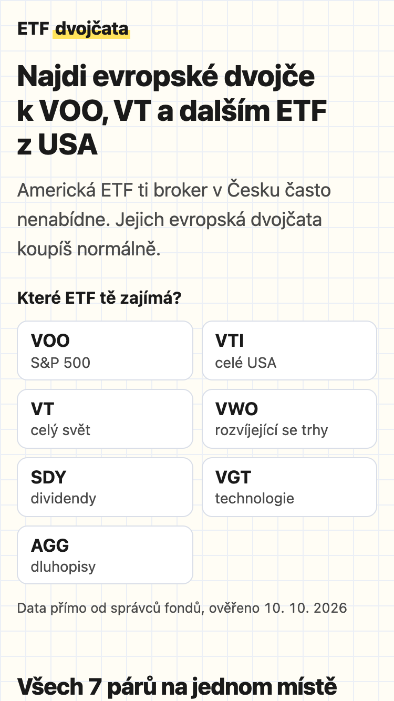 | 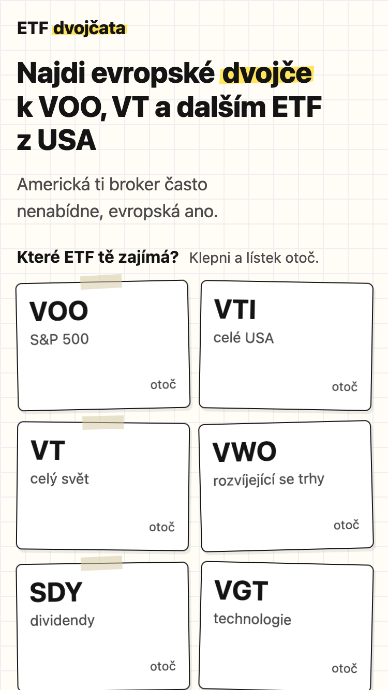 |
| Výběr ETF | 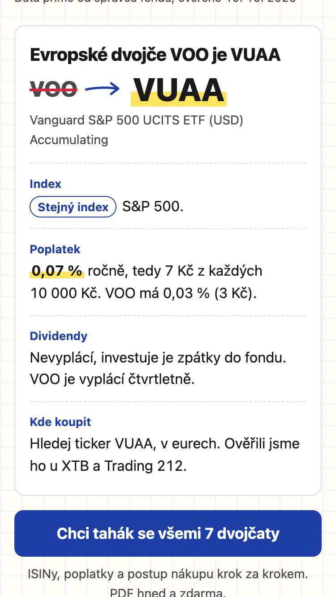 | 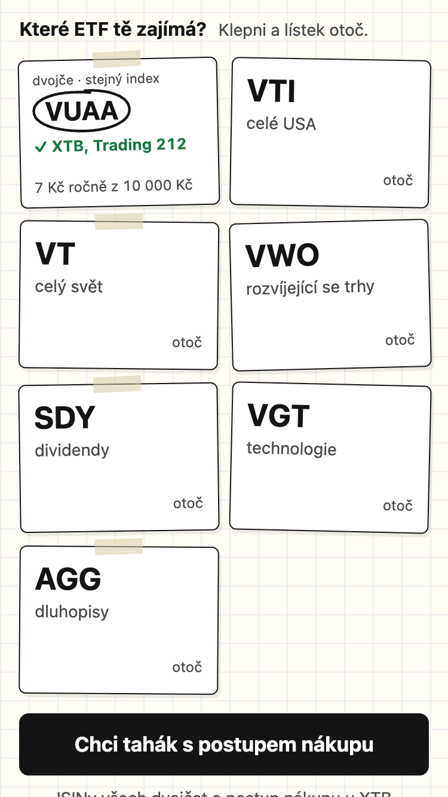 |
| Karty párů | 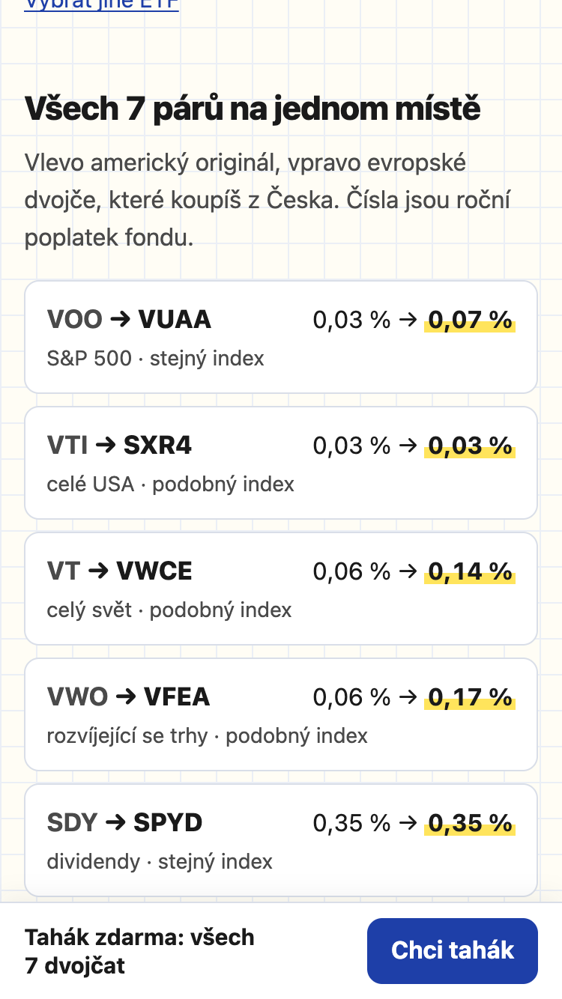 | 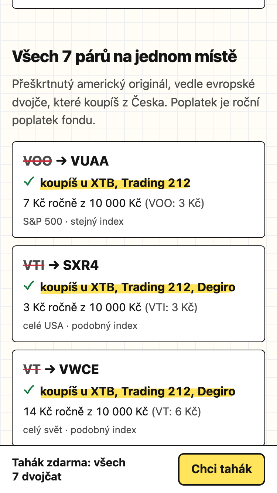 |
| Formulář | 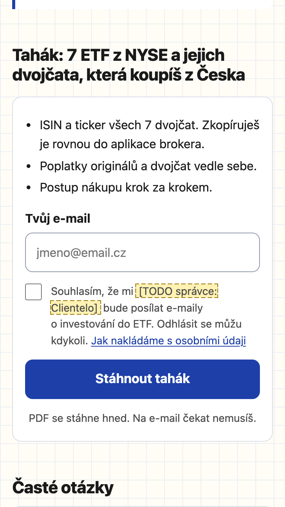 | 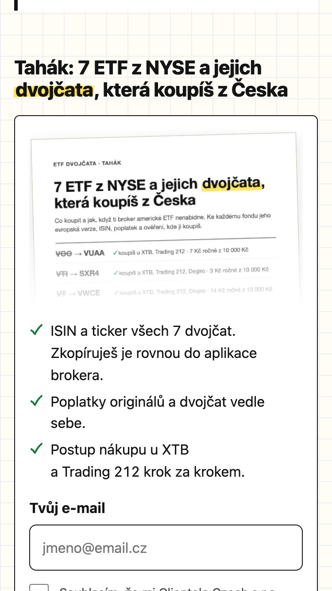 |
| Poděkování | 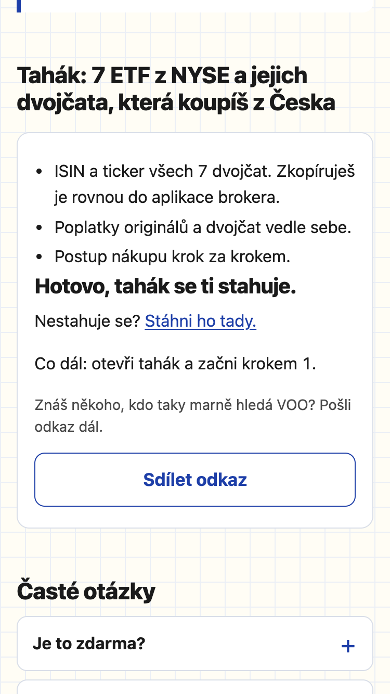 | 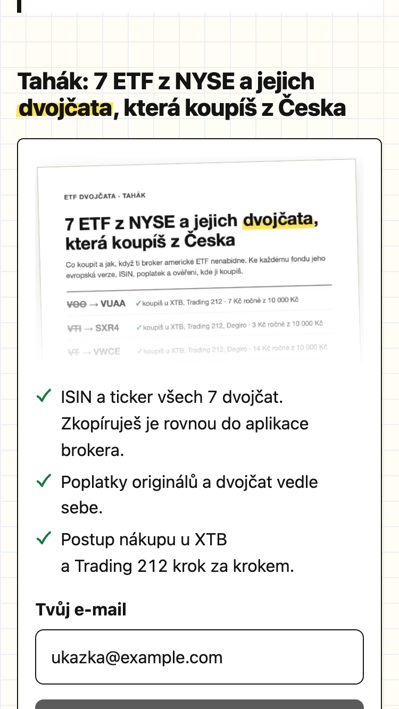 |

Varianty úvodu po: [?v=dvojce](docs/screenshots/po-1b-uvod-dvojce.png), [?v=zacatek](docs/screenshots/po-1c-uvod-zacatek.png).

**Druhý test na skutečném iPhonu, zase člověk** (Safari, 10. 10. 2026). Design a lístky fungovaly, ale objevily se chyby, které headless Chrome neukázal:

- Po klepnutí do pole e-mail v panelu ze spodní lišty panel odskočil nahoru, nadpis zajel pod horní lištu telefonu, pole zmizelo pod klávesnicí a pod panelem prosvítala stránka. Příčina: iOS při klávesnici zmenší jen visual viewport, pevně umístěný panel nechá pod klávesnicí a posouvá stránku i panel. Navíc fokus šel do pole ještě během animace panelu. Oprava a test ve WebKitu jsou popsané v sekci [Testování](#testování-co-automaticky-a-co-jen-na-telefonu).
- V logu serveru bylo `GET /tahak.pdf` s 404 hned po úspěšném HEAD. Zopakovat se to nepodařilo a přegenerováním PDF to nebylo (PDF se naposledy zapsalo o 22 minut dřív). Generování teď zapisuje přes dočasný soubor a lokální server u každé 404 vypíše, kde soubor hledal.
- Safari PDF místo stažení otevřelo v prohlížeči, takže poděkování „tahák se ti stahuje“ neplatilo. Teď je tam tlačítko „Otevřít tahák“.
- Poděkování bylo prázdné, zásady měly moc žlutých TODO, chyběla favicona.

AI navíc při kontrole na 320 px našla, že zadní strana lístku se třemi brokery přetékala přes další řadu, a že headless WebKit nerespektuje `backface-visibility` (rub prosvítal). Obojí je opravené a hlídané testem.

Panel a formulář na místě s otevřenou klávesnicí ve WebKitu (simulace, viz [scripts/test-webkit.mjs](scripts/test-webkit.mjs)):

| | iPhone SE 1. gen. (320 px) | iPhone SE 3. gen. (375 px) | iPhone 13 (390 px) |
|---|---|---|---|
| Panel ze spodní lišty | 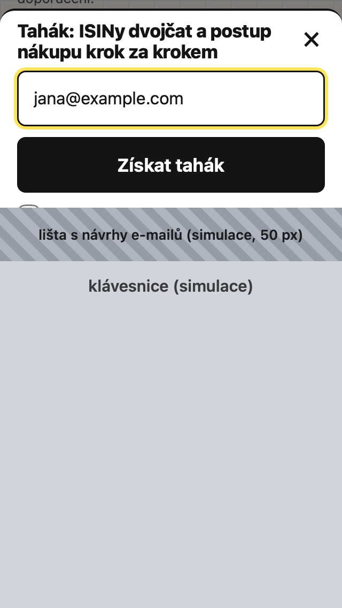 | 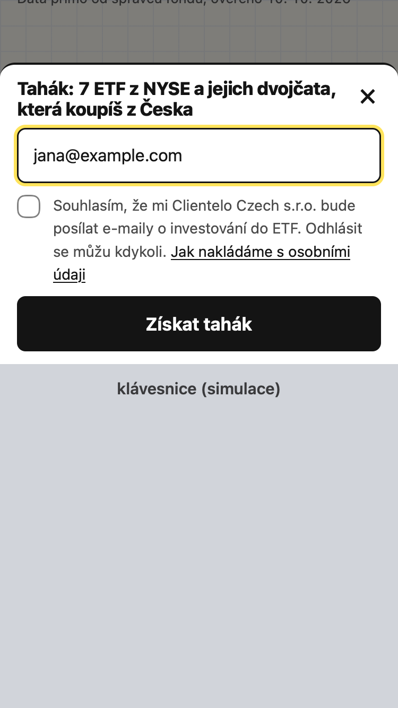 | 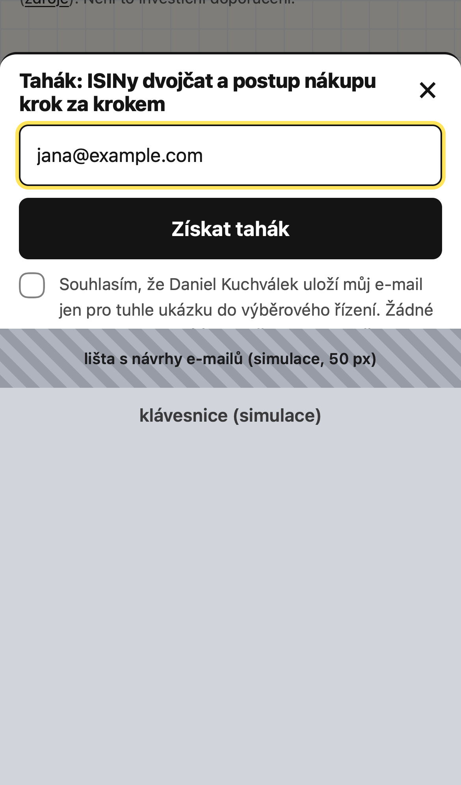 |
| Formulář pod lístky | 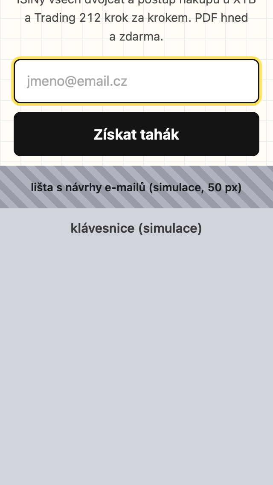 | 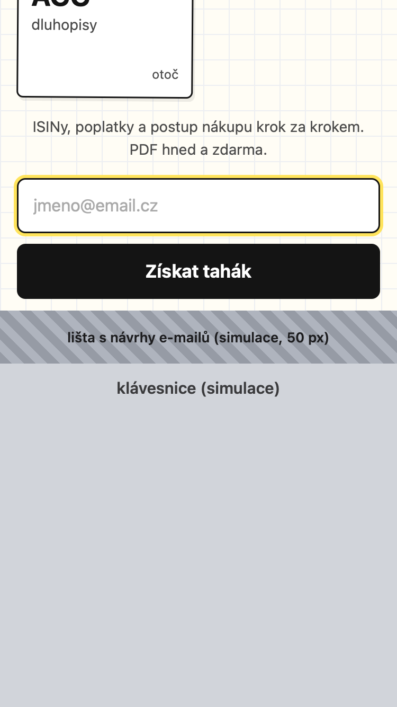 | 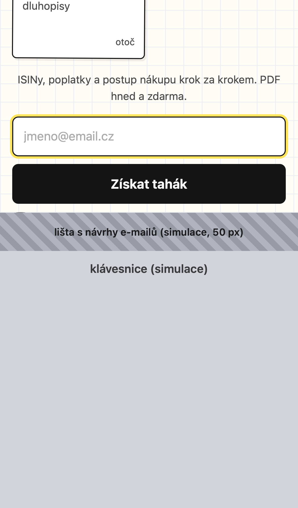 |

## Před spuštěním kampaně

Co musí doplnit nebo rozhodnout někdo jiný než vývojář. V návrhu zásad jsou tato místa nenápadně označená „doplní správce“.

**Správce (Clientelo Czech s.r.o.):**

- kontaktní e-mail pro otázky k osobním údajům,
- e-mailová služba pro rozesílání (je to další zpracovatel, patří do zásad),
- nejdelší doba uložení e-mailu,
- jak dlouho Vercel uchovává záznamy o přístupu (IP adresy) na zvoleném tarifu,
- potvrdit, že e-maily neprodává ani nepředává dalším firmám (pak to doplnit do zásad),
- přijmout smlouvy o zpracování osobních údajů (DPA) u Supabase a Vercelu.

**Právník:**

- jestli smí být tahák podmíněný souhlasem s marketingovými e-maily, nebo má být souhlas dobrovolný a tahák dostane každý (souhlas musí být svobodný),
- právní základ měření bez cookie lišty. Do prohlížeče nic neukládáme, ale i odesílání dat z prohlížeče může podle výkladu Evropského sboru pro ochranu osobních údajů (pokyny 2/2023) vyžadovat souhlas. Tenhle výklad jsme z primárního zdroje neověřovali,
- předávání údajů mimo EU: Supabase i Vercel jsou americké firmy, i když data a funkce jsou ve Frankfurtu,
- celý návrh [zásad ochrany osobních údajů](public/ochrana-osobnich-udaju.html) a text souhlasu u formuláře.

**Vývojář (před ostrou kampaní):**

- sledovat v logu Vercelu zamítnuté pokusy (`[lead] zamítnuto: …`). Kdyby spam prošel přes limity, přidat CAPTCHA (například Cloudflare Turnstile) a s právníkem probrat, co to znamená pro souhlas,
- ověřit, že denní dotaz z keep-alive Supabase opravdu počítá jako aktivitu (předpoklad, z dokumentace neověřený),
- [nasadit podle návodu](#nasazení-na-supabase-a-vercel) a projít kontrolu po nasazení.

**Až stránku Clientelo převezme:**

- odebrat `noindex`: meta tag v `public/index.html` a hlavičku `X-Robots-Tag` ve `vercel.json`, a poznámku „Ukázkové řešení do výběrového řízení“ v patičce. Do té doby ji vyhledávače neindexují (Lighthouse proto v kategorii SEO hlásí „stránka je blokovaná pro indexování“, to je záměr).

**Po nasazení (vývojář):**

- sladit adresu v `og:image` v `public/index.html` se skutečnou doménou. Je tam `https://etf-dvojcata-clientelo.vercel.app/og.png`, protože `etf-dvojcata.vercel.app` už používá cizí projekt. Pak odkaz zkontrolovat v [nástroji pro ladění sdílení od Facebooku](https://developers.facebook.com/tools/debug/).

## Co v řešení chybí

_TODO: co se nestihlo nebo bylo vědomě vynecháno a co by bylo potřeba před ostrým spuštěním reklamy._
